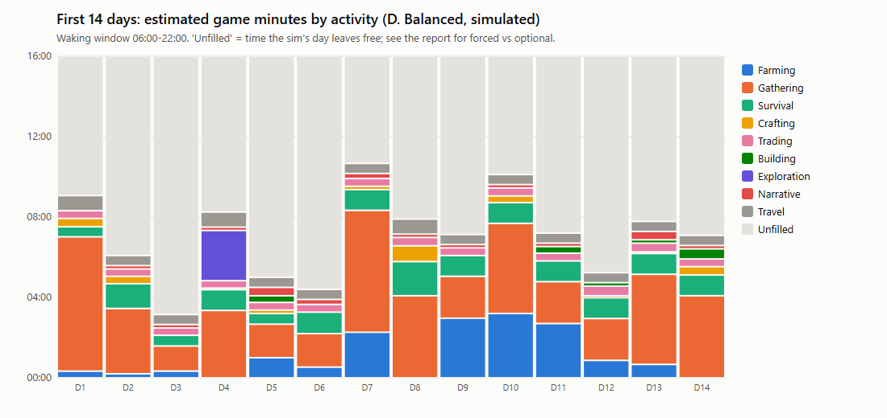
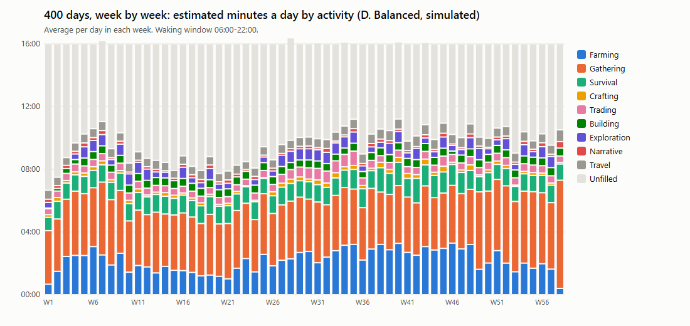
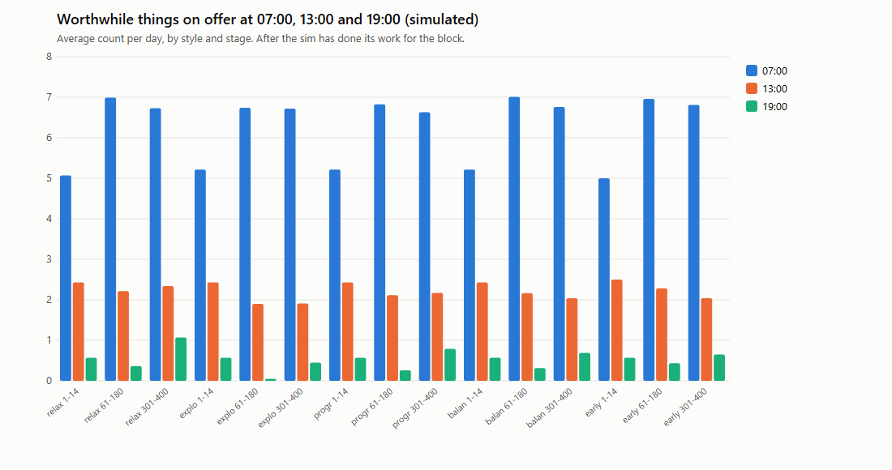

# CCH-LOOP-001 — Daily activity and idle-time audit

**Status:** audit complete, stopped for owner and ChatGPT review (2026-11-13). Prepared by Claude Code. **Nothing
here is implemented or approved.** Every opportunity in section H is an unapproved design suggestion. No game code
was changed for this audit, and no reward, rate or balance number was touched.
**Build:** the repaired build, commit `2a4748f` (CCH-PLAYABLE-002).
**Evidence:** `art/style_tests/CCH-LOOP-001/` (`logs/loop_<style>.log`, the raw probe output; `out/tables.md`, every
table; `out/*.png` and `*.svg`, the charts; `out/played_timeline.md`, the played timelines).
**Tools:** `tools/loop_audit.gd` (the probe), `tools/loop_audit.py` (tables and charts), `tools/loop_playlog.py`
(timelines from the play logs). All run in throwaway profiles.

## Method: what was measured, and how far to trust it

There are two kinds of evidence. They are kept apart throughout.

| | **Played** (input-driven) | **Simulated** |
| --- | --- | --- |
| What | The CCH-PLAYABLE-001 play bot, on the repaired build: real windowed game from the title menu, injected keys, mouse and Xbox input only, 8 days on each device. | `tools/loop_audit.gd`: the balance sim's day (the game's own functions, no walking) for 400 days in 5 configurations, with the game's state read at 6 points of every day. |
| Time | Real game-clock timestamps of every message and action. | **Estimated**: the sim does the day in fixed blocks, so minutes = counts of each action x a unit time measured from the played logs (the median gap before each kind of message, which includes walking). Reported at bot pace and at a "brisk" 60%, which is an assumption. |
| Limits | A bot, not a person. It does what the diary and messages direct and then **waits**; it never wanders, fishes for fun or explores the cave without a reason. Its waiting measures **how much the game directs**, not how bored a person would be. It follows the tutorial to bed at 19:15. | The sim's strategy does everything it judges worthwhile each day, efficiently. It never fishes for sale, never explores the cave beyond ore, never sits at the bench. Its "free time" is what is left after an efficient routine. |

**Activity statuses** (at each checkpoint, read from the game's real state):
- **fresh** (counted as "worth doing"): something new worth doing now: water or harvest a crop, plant, forage that has
  appeared, brush, farm rocks, sell today's goods, a needed seed order, a new tool tier, a due chore (tidy, mend at the
  due wear), a house repair, a cleanse, hungry animals, a walker visiting (till 16:00), a trek on offer, the day's
  happening.
- **repeatable**: always available but the same as yesterday: felling, fishing, the cave after the day's first visit
  (counted repeatable throughout: it has a new layout but the same loop), cooking, optional catalog spending, mending
  past the due wear.
- **leisure**: a desk pastime (cards, sudoku).
- **wait / locked / unclear**: not now; needs a tool, building, level or season; or never pointed out to the player.

**Checkpoints:** 06:00 (wake), 07:00 (out of the door), 13:00 (after the morning's work), 19:00 (dusk, after the
afternoon), and 22:00 (the night's visitor) or 21:00 (bed, in the early-bed style).

**Metrics** (exact definitions; none is an engagement score):
- **Active time**: estimated minutes of the sim's actions in the waking window (06:00-22:00; 06:00-21:00 early-bed),
  as a share of that window.
- **Low-choice free time**: the unfilled part of the window, counted half for the afternoon and half for the evening,
  for each half where the checkpoint shows **no fresh thing**, only repeatable work or leisure. **Forced idle**: the
  same but with nothing at all on offer. **Free with fresh choices**: the rest.
- **Worth doing at hh:00**: number of fresh things on offer at that checkpoint.
- **Activity diversity**: distinct categories with any time that day.
- **Days with progress**: share of days with a progress event: a chapter, a homestead step, a house stage, a lantern,
  a trek walked, or a new thing made or built.
- **Days to next progress**: from each day, days until the next progress event.
- **Repetition**: the share of today's kinds of action (plant, water, fell ...) that were also done yesterday.

**Play styles** (sim configurations): **A. Relaxed farmer**: stays in at night (no confrontation), 1 trek a week.
**B. Explorer**: faces the nights, 6 treks a week. **C. Progression-focused**: faces the nights, 3 treks a week (the
sim's standard efficient strategy). **D. Balanced**: faces the nights, 2 treks a week. **E. Tutorial early-bed**: in
bed at 21:00 before the visitor, 3 treks a week. All five do the same farm and house routine: the sim cannot vary
taste, only nights and treks, so the styles differ less than real players would.

## A. Executive summary

**Is the daily loop sufficiently populated?** **Mornings are full; afternoons are thin; evenings are nearly empty.**
After an efficient morning, about **2 fresh things** are on offer at 13:00 (selling the day's goods, and on 62% of days a
trek; on 18% a walker visiting). By 19:00 there is **no fresh thing at all on two days in three** (66% balanced, 79%
explorer). What remains is felling, fishing, the cave again, cooking and a desk pastime. The evening from dusk to
the 22:00 visitor (3 game hours, which is one real minute; see C) is the emptiest part of
the day, and the tutorial's "bed from 18:00" advice sends a new player past it altogether.

Measured or estimated the same way across styles, a day is roughly **55-65% active at bot pace (34-39% brisk)**,
**10-14% low-choice** (only repeatable things left), and essentially **never forced idle** (fishing, felling and the
cave are always there). So the game does not leave the player with *nothing* to do. It leaves them with **the same
things to do**: repetition is **84-90%** of each day's kinds of action.

**Strongest parts:** the first two weeks (progress on 71% of days, a new event every 1.3 days); the morning round
(harvest, water, forage that moves, brush, the day's happening on 75% of mornings, the morning report as a briefing);
the treks, which make the explorer the style with the most progress (55% of days, every 1.9 days); and the nights,
which give every evening one strong event.

**Weakest parts:** the 19:00-22:00 evening; the mid game from about day 60 (progress on 22-27% of days, every 3-4
days); winter (progress on 23% of days, fewest farm minutes); felling as the biggest single time sink (estimated 2-4
hours a day of gathering, mostly trees, in every style); and the relaxed farmer's summer, with a **55-day stretch with
no progress event** (days 288-342), against 10 days for the balanced and explorer styles.

## B. The first 14 days

### Played (input-driven, keyboard; the controller run is in `out/played_timeline.md` and is the same in shape)

Game minutes from 06:00 to bed per category, from the bot's log; "Waiting" = a gap of over 45 minutes with nothing
said or done (the bot had no directed task). Hour-by-hour: the main activity in each hour.

| Day | To bed | Farming | Gathering | Survival | Crafting | Trading | Building | Exploration | Combat | Narrative | Travel | Other | Waiting | Played window |
| --- | --- | --- | --- | --- | --- | --- | --- | --- | --- | --- | --- | --- | --- | --- |
| 1 | 23:04 | 59 | 142 | 34 | 2 | 0 | 0 | 0 | 0 | 136 | 0 | 50 | 601 | 1024 min |
| 2 | 19:17 | 0 | 68 | 34 | 0 | 0 | 0 | 0 | 0 | 84 | 0 | 0 | 558 | 797 min |
| 3 | 19:16 | 0 | 63 | 30 | 0 | 34 | 0 | 0 | 0 | 54 | 0 | 0 | 548 | 796 min |
| 4 | 19:16 | 33 | 150 | 31 | 1 | 0 | 0 | 40 | 0 | 107 | 35 | 17 | 320 | 796 min |
| 5 | 19:17 | 0 | 140 | 60 | 0 | 24 | 0 | 0 | 0 | 63 | 43 | 0 | 467 | 797 min |
| 6 | 19:16 | 0 | 161 | 14 | 0 | 0 | 0 | 0 | 0 | 0 | 0 | 0 | 621 | 796 min |
| 7 | 19:17 | 61 | 197 | 2 | 0 | 0 | 0 | 0 | 0 | 0 | 0 | 0 | 474 | 797 min |
| 8 | 19:17 | 60 | 149 | 41 | 0 | 7 | 0 | 0 | 0 | 33 | 33 | 0 | 409 | 797 min |

Hour by hour (main activity in each game hour; '.' = in bed):

| Day | 06 | 07 | 08 | 09 | 10 | 11 | 12 | 13 | 14 | 15 | 16 | 17 | 18 | 19 | 20 | 21 | 22 | 23 |
| --- | --- | --- | --- | --- | --- | --- | --- | --- | --- | --- | --- | --- | --- | --- | --- | --- | --- | --- |
| 1 | Narra | Narra | Narra | Survi | Waiti | Waiti | Gathe | Waiti | Waiti | Waiti | Waiti | Waiti | Waiti | Waiti | Waiti | Waiti | Other | Survi |
| 2 | Narra | Gathe | Waiti | Waiti | Waiti | Waiti | Waiti | Waiti | Gathe | Waiti | Waiti | Waiti | Waiti | . | . | . | . | . |
| 3 | Narra | Gathe | Tradi | Waiti | Waiti | Waiti | Waiti | Waiti | Waiti | Waiti | Waiti | Waiti | Gathe | . | . | . | . | . |
| 4 | Narra | Survi | Gathe | Gathe | Waiti | Narra | Narra | Waiti | Waiti | Waiti | Waiti | Waiti | Gathe | . | . | . | . | . |
| 5 | Narra | Gathe | Survi | Waiti | Gathe | Waiti | Waiti | Waiti | Waiti | Waiti | Waiti | Waiti | Waiti | Waiti | . | . | . | . |
| 6 | Gathe | Gathe | Gathe | Waiti | Waiti | Waiti | Waiti | Waiti | Waiti | Waiti | Waiti | Waiti | Waiti | Waiti | . | . | . | . |
| 7 | Farmi | Waiti | Waiti | Gathe | Gathe | Gathe | Waiti | Waiti | Waiti | Waiti | Waiti | Waiti | Gathe | . | . | . | . | . |
| 8 | Farmi | Survi | Gathe | Waiti | Gathe | Gathe | Waiti | Waiti | Waiti | Waiti | Waiti | Waiti | Gathe | . | . | . | . | . |

What it shows (played): the directed work (the guide, the brush, the trees, a planting, the stand, the trek on day 4)
is done by about **12:00**, and from 13:00 to bed the bot has nothing the game has pointed it to, every day. After the
first day the diary's guide is over; the chapters then ask for things that take days (a first crop, sales, Farming 2),
so they give no "what next this afternoon". The bot goes to bed at 19:15 as chapter 1 and the sleep page teach.
Narrative minutes are the reading of pages and reports; they are high on days 1-4 and fall away after.

### Simulated (D. Balanced): estimated minutes and what was on offer

| Day | Weather | Sanity | Farm | Gather | Survive | Craft+trade | House | Trek | Travel | Active | Active % | Worth doing 07/13/19 | Progress |
| --- | --- | --- | --- | --- | --- | --- | --- | --- | --- | --- | --- | --- | --- |
| 1 | drizzle | 85 | 0:20 | 6:41 | 0:30 | 0:48 | 0:00 | 0:00 | 0:45 | 9:04 | 57% | 3 / 3 / 0 | - |
| 2 | rain | 87 | 0:12 | 3:15 | 1:14 | 0:44 | 0:00 | 0:00 | 0:30 | 6:05 | 38% | 4 / 1 / 0 | chapter, made 2 |
| 3 | drizzle | 70 | 0:20 | 1:15 | 0:32 | 0:22 | 0:00 | 0:00 | 0:30 | 3:09 | 20% | 4 / 1 / 0 | - |
| 4 | sunny | 75 | 0:00 | 3:21 | 1:02 | 0:27 | 0:00 | 2:30 | 0:45 | 8:15 | 52% | 6 / 5 / 3 | trek, made 1 |
| 5 | cloudy | 77 | 1:00 | 1:40 | 0:32 | 0:33 | 0:20 | 0:00 | 0:30 | 5:00 | 31% | 7 / 5 / 1 | chapter, made 2 |
| 6 | drizzle | 79 | 0:32 | 1:40 | 1:04 | 0:23 | 0:00 | 0:00 | 0:30 | 4:24 | 28% | 3 / 2 / 0 | homestead step |
| 7 | fog | 72 | 2:16 | 6:04 | 1:02 | 0:33 | 0:00 | 0:00 | 0:30 | 10:40 | 67% | 5 / 3 / 0 | homestead step, lantern, made 2 |
| 8 | drizzle | 74 | 0:00 | 4:05 | 1:42 | 1:12 | 0:00 | 0:00 | 0:45 | 7:54 | 49% | 3 / 1 / 0 | made 7 |
| 9 | cloudy | 73 | 2:58 | 2:05 | 1:02 | 0:23 | 0:00 | 0:00 | 0:30 | 7:08 | 45% | 6 / 1 / 0 | - |
| 10 | cloudy | 69 | 3:12 | 4:29 | 1:02 | 0:44 | 0:00 | 0:00 | 0:30 | 10:07 | 63% | 7 / 2 / 1 | chapter, made 4 |
| 11 | cloudy | 38 | 2:42 | 2:05 | 1:02 | 0:23 | 0:20 | 0:00 | 0:30 | 7:12 | 45% | 6 / 2 / 1 | chapter |
| 12 | rain | 52 | 0:52 | 2:05 | 1:02 | 0:35 | 0:10 | 0:00 | 0:30 | 5:14 | 33% | 5 / 2 / 1 | - |
| 13 | rain | 48 | 0:40 | 4:29 | 1:02 | 0:31 | 0:10 | 0:00 | 0:30 | 7:47 | 49% | 9 / 4 / 1 | homestead step, house stage, made 1 |
| 14 | drizzle | 47 | 0:00 | 4:05 | 1:02 | 0:48 | 0:30 | 0:00 | 0:30 | 7:05 | 44% | 5 / 2 / 0 | made 5 |

### Play styles over 400 simulated days

Days 1-14 in the sim: active 44% of the window, progress on 71% of days (a chapter, the lantern, the trek, the Boarded
house, the second plot), fresh things on offer 3-9 in the morning, 1-5 at 13:00 and 0-3 at 19:00. Day 3 (about 3 hours
of work) and days 5-6 (4-5 hours) are thin, and days 3, 9 and 12 have no progress event: rain waters the crops, the
brush has not grown back (it regrows every 3 days), and no walker is at the gate.

## C. Seasons (D. Balanced)

| Season | Days | Farm | Gather | Trek | Craft/trade/house | Active | Low-choice free | Worth doing 13:00 | Worth doing 19:00 | Days with progress |
| --- | --- | --- | --- | --- | --- | --- | --- | --- | --- | --- |
| Y1 Autumn | 1-61 | 2:08 | 3:56 | 0:24 | 1:00 | 58% | 18% | 1.8 | 0.1 | 57% |
| Y1 Winter | 62-151 | 1:29 | 3:30 | 0:28 | 1:06 | 53% | 17% | 2.1 | 0.3 | 23% |
| Y1 Spring | 152-243 | 2:21 | 3:31 | 0:32 | 1:19 | 60% | 16% | 2.1 | 0.2 | 26% |
| Y1 Summer | 244-334 | 2:58 | 3:33 | 0:29 | 1:12 | 65% | 6% | 1.9 | 0.6 | 22% |
| Y2 Autumn | 336-400 | 1:53 | 4:41 | 0:34 | 1:08 | 63% | 5% | 2.1 | 0.7 | 31% |

- **Autumn (first)**: the richest season for progress (57% of days), because the early game is in it.
- **Winter** (days 62-151): the fewest farm minutes (1:29 a day: few crops grow), the lowest active share (53%) and
  progress on only 23% of days. Gathering and treks fill it; the evenings are long and dark. This is where a player is
  most likely to feel the farm has nothing for them.
- **Spring and summer**: farm minutes rise (2:21, 2:58), low-choice time falls to 6% in summer (the most crops, the
  restoration in summer, the flowers), but progress stays at 22-26% of days.
- **Rainy days** (44% of days in the balanced run are wet): rain waters every crop, which removes the watering round;
  wet days are the thin days of the first fortnight.
- A game hour is 20 real seconds on the farm, so the 19:00-22:00 evening is **one real minute**; the "empty evening"
  is short in real time. It matters because it is the same minute every night, and because the player has nothing to
  prepare for in it unless they mean to face the visitor.

## D. Play styles

| Style | Active, bot pace (brisk) | Forced idle | Low-choice free | Free with fresh choices | Categories/day | Worth doing 07/13/19 | Days with progress | Repetition | Days to next progress |
| --- | --- | --- | --- | --- | --- | --- | --- | --- | --- |
| A. Relaxed farmer | 57% (34%) | 0% | 13% | 30% | 7.6 | 6.7 / 2.1 / 0.5 | 22% | 87% | 7.6 |
| B. Explorer | 64% (39%) | 0% | 14% | 22% | 7.9 | 6.6 / 1.9 / 0.2 | 55% | 84% | 1.9 |
| C. Progression-focused | 59% (35%) | 0% | 13% | 28% | 7.7 | 6.7 / 2.0 / 0.4 | 38% | 86% | 3.0 |
| D. Balanced | 60% (36%) | 0% | 13% | 28% | 7.6 | 6.8 / 2.0 / 0.4 | 30% | 86% | 3.2 |
| E. Tutorial early-bed | 64% (38%) | 0% | 10% | 26% | 7.6 | 6.8 / 2.1 / 0.5 | 34% | 87% | 3.5 |

- **A. Relaxed farmer**: progress on 22% of days, every 7.6 days on average, with the longest gap of any style (55
  days, 288-342: late summer, all homestead steps and buildings done, no treks to speak of). The relaxed player's
  reasons to play another day are crops and money, and money has little to buy once the house is done.
- **B. Explorer**: the most progress (55% of days, every 1.9 days) and the most active days; treks are the strongest
  reward in the game (routes, pages, trail works, folk hearts, coins). It also has the emptiest evenings (79% with no
  fresh thing at 19:00): it spends the afternoon in the wood.
- **C. Progression-focused** and **D. Balanced**: in between, progress every 3 days.
- **E. Early-bed**: much as C (the farm routine is the same) but sees no night at all.
- For every style the routine is the same farm loop: harvest, water, plant, brush, trees, forage, stand, chores. The
  styles differ only in treks and nights. **Uneven rewards**: one activity (treks) produces most of the progress
  events after day 60; the farm produces coins and crops, but coins buy fewer new things as the year goes on.

## E. Activity availability through the day (D. Balanced, 400 days)

| Activity | 06:00 | 07:00 | 13:00 | 19:00 | 22:00 |
| --- | --- | --- | --- | --- | --- |
| water | worth 57%, wait 43% | worth 57%, wait 43% | wait 100%, worth 0% | wait 100%, worth 0% | wait 100%, worth 0% |
| harvest | worth 90%, wait 10% | worth 90%, wait 10% | wait 100% | wait 100% | wait 100% |
| plant | worth 100%, wait 0% | worth 100%, wait 0% | worth 96%, wait 4% | worth 96%, wait 4% | worth 96%, wait 4% |
| forage | worth 100% | worth 100% | wait 96%, worth 4% | wait 96%, worth 4% | wait 96%, worth 4% |
| brush | wait 66%, worth 34% | wait 66%, worth 34% | wait 100% | wait 100% | wait 100% |
| fell | repeat 100%, locked 0% | repeat 100%, locked 0% | repeat 100% | repeat 100% | repeat 100% |
| rocks | wait 93%, worth 7% | wait 93%, worth 7% | wait 100%, locked 0% | wait 100% | wait 100% |
| cave | worth 100%, locked 0% | worth 100%, locked 0% | worth 93%, repeat 7% | worth 93%, repeat 7% | worth 93%, repeat 7% |
| sell | worth 99%, wait 1% | worth 99%, wait 1% | worth 100% | repeat 86%, wait 14% | wait 100% |
| catalog | repeat 98%, wait 1% | repeat 98%, wait 1% | repeat 96%, worth 3% | repeat 96%, worth 4% | repeat 96%, worth 4% |
| craft | wait 100% | wait 100% | wait 100%, worth 0% | wait 100% | wait 100% |
| cook | repeat 88%, wait 12% | repeat 84%, wait 16% | repeat 92%, wait 8% | repeat 88%, wait 12% | repeat 87%, wait 13% |
| tidy | worth 97%, locked 3% | wait 97%, locked 3% | wait 97%, locked 3% | wait 97%, locked 3% | wait 97%, locked 3% |
| mend | repeat 84%, worth 10% | repeat 89%, wait 10% | repeat 94%, wait 4% | repeat 93%, wait 6% | repeat 93%, wait 6% |
| repair | locked 61%, wait 39% | locked 61%, wait 39% | locked 60%, wait 39% | locked 61%, wait 39% | locked 61%, wait 39% |
| cleanse | wait 100%, worth 0% | wait 100% | wait 100%, worth 0% | wait 100%, worth 0% | wait 100%, worth 0% |
| animals | wait 65%, worth 33% | wait 65%, worth 33% | wait 89%, worth 9% | wait 90%, worth 9% | wait 90%, worth 9% |
| folk | wait 81%, worth 18% | wait 81%, worth 18% | wait 81%, worth 18% | wait 99%, locked 1% | wait 99%, locked 1% |
| trek | worth 62%, wait 37% | worth 62%, wait 37% | worth 62%, wait 37% | wait 79%, worth 20% | wait 99%, locked 1% |
| happening | worth 75%, wait 25% | worth 75%, wait 25% | wait 100%, worth 0% | wait 100% | wait 100% |
| night | wait 100% | wait 100% | wait 100% | wait 86%, worth 14% | worth 100% |
| fish | repeat 100% | repeat 100% | repeat 100% | repeat 100% | repeat 100% |
| pastime | leisure 95%, wait 5% | leisure 95%, wait 5% | leisure 95%, wait 5% | leisure 92%, wait 8% | leisure 76%, wait 24% |

Reading it: the morning has 5-7 fresh things on almost every day; by 13:00 only selling (every day), a trek (62% of
days) and a walker (18%) are reliably fresh; by 19:00 only a night trek (20%), hungry animals or a little forage.
**Available but unrewarding or unclear:** fishing is always available and the sim never fishes for money (fish
income 0 in every run: a perch is worth little next to cooked food), so it is an **unused system** for income;
cooking is the biggest late income (5,409 coins in the balanced run) but is always the same few recipes;
the catalog after the house is done offers little the player needs. **Progression-locked for long:** the house
repair (locked 61% of the year: Restored needs Carpentry 8 and summer), the cleanse (after chapter 9 it is only for a
lost limit).

## F. Idle-time findings, ranked

1. **The evening (19:00-22:00) is empty of fresh choices on 59-79% of days**, in every style and season. Nothing new
   happens at dusk except, on some days, a night trek. The only scheduled evening event is the visitor at 22:00, and
   the tutorial sends the new player to bed before it. *(Simulated checkpoint data; played: the bot was in bed by 19:15
   every night, as taught.)*
2. **The afternoon after the stand** is thin: after selling, a trek is the only substantial fresh activity, and only on
   walker days (about 3 in 5). On the other days the afternoon is felling, fishing and the cave. *(Simulated; played:
   the bot had nothing directed from about 13:00 on every day of the week.)*
3. **The mid game, days 60-180 (winter and early spring):** progress on 22% of days, every 3.7 days, repetition 87%;
   the longest stretches without progress for the progression and early-bed styles (19-20 days) fall in the second
   year's summer. *(Simulated.)*
4. **The relaxed farmer's late year:** a 55-day stretch with no progress event once the homestead is done.
   *(Simulated.)*
5. **Thin days in the first fortnight** (wet days with no brush and no walker): 2-3 hours of work and nothing new.
   *(Simulated; matches the played days 2, 3 and 6, each with 9+ hours of waiting.)*
6. **Not idle, but repetitive:** felling. The sim fells up to 6 trees a day while the woodpile is under 200, the largest
   time sink in every style; a player who does less will have more empty time, not less. *(Estimated.)*

What is **not** a problem: the morning; the first week's density; the nights as events; real forced idleness (there
is always something to do, if only fishing and felling). Quiet time exists, and some of it is the point: the pastimes
at the desk and the bench are deliberate leisure.

## G. Reward and progression gaps

| Stage | Active | Low-choice free | Worth doing 13:00 | Worth doing 19:00 | Days with progress | Repetition | Days to next progress |
| --- | --- | --- | --- | --- | --- | --- | --- |
| Days 1-14 | 44% | 16% | 2.4 | 0.6 | 71% | 69% | 1.3 |
| Days 15-60 | 62% | 19% | 1.6 | 0.0 | 54% | 83% | 2.1 |
| Days 61-180 | 53% | 16% | 2.2 | 0.3 | 22% | 87% | 3.7 |
| Days 181-300 | 63% | 12% | 1.9 | 0.3 | 26% | 87% | 3.2 |
| Days 301-400 | 64% | 6% | 2.0 | 0.7 | 27% | 90% | 3.3 |

| Style | Three longest gaps |
| --- | --- |
| A. Relaxed farmer | 55 days (288-342); 19 days (247-265); 13 days (365-377) |
| B. Explorer | 10 days (333-342); 7 days (283-289); 5 days (276-280) |
| C. Progression-focused | 19 days (331-349); 8 days (154-161); 7 days (93-99) |
| D. Balanced | 10 days (142-151); 7 days (154-160); 6 days (379-384) |
| E. Tutorial early-bed | 20 days (268-287); 13 days (289-301); 11 days (381-391) |

- **Small accomplishments within a day:** strong in the first fortnight (chapters, guide steps, first tools, the trek)
  and on trek days; weak on non-trek days after day 60, when a day's work yields coins and XP but rarely a new thing.
- **Medium goals over several days:** the homestead steps carry days 5-60 well; after them the next goals (Restored in
  summer, the bell parts, the extensions, the deed) are weeks to months away.
- **Long goals over seasons:** present (the house, the bell, the second year's act, the endings).
- **Unexpected discoveries:** the daily happening (75% of mornings) and the torn pages; the farm itself has few
  discoveries after the first weeks (forage spots move, brush regrows).
- **Increasing capability:** tool and lantern tiers come early (all lantern tiers in the first months); after that,
  capability grows mostly as levels.
- **Effort without a satisfying outcome:** felling past need, fishing (low value), mending past the due wear, and coins
  late in the year (little left to buy).

## H. Gameplay opportunities (UNAPPROVED design suggestions, ranked)

None of these is approved or built. They are ranked by how much of the measured gap each could fill, weighted to
reuse what exists. Complexity: S (a few lines and text), M (a focused session), L (more than one session).

1. **An evening that prepares for the night.** *Problem:* F1. *When:* 19:00-22:00, from week one. *Systems:*
   NightSystem (the visitor is already chosen at dusk), lamp posts, the lantern, the house, snares and fences. *What:*
   small, visible preparation with a payoff that night: light the lamps, bar the shutters, set a snare, leave an
   offering at the field's edge, read the signs of tonight's visitor (tracks, crows, a cold spot). *Gives:* survival,
   meaningful choice (face it or prepare and sleep). *Fit:* the folk-horror dusk. *Chore risk:* medium, if it becomes
   a checklist every night; keep it to one or two choices tied to tonight's visitor. *M. Early to late.*
2. **Hearth evenings: processing and keeping at the fire.** *Problem:* F1, uneven cooking. *When:* evenings, indoors.
   *Systems:* firewood, cooking, the smokehouse and cellar, the desk. *What:* evening-only processing (preserves,
   mending clothes for warmth, carving charms, reading Agnes's pages and the almanac) that turns the day's surplus into
   something the next day uses. *Gives:* resources, relaxation. *Fit:* cozy, by the fire. *Chore risk:* low if
   optional. *M. Early to late.*
3. **Afternoon errands from the lane (more folk days).** *Problem:* F2, F5. *When:* afternoons without a walker.
   *Systems:* FolkSystem requests and hearts, the stand, the mailbox. *What:* a visitor or a letter on more days, with
   a small same-day ask (bring three apples by four, look for a lost goat at the orchard). *Gives:* character, coins,
   story. *Fit:* the lane's people already exist. *Chore risk:* low-medium. *S-M. Early to mid.*
4. **Short farm-edge walks without a walker.** *Problem:* F2, F3; treks are the best reward but need a walker. *When:*
   afternoons, any day. *Systems:* TrekSystem clearings, forage, the wood's dread. *What:* a one-clearing foray into the
   edge of the wood for forage, a page, storm oak, alone, with the same light and nerve rules applied to yourself.
   *Gives:* discovery, resources. *Fit:* strong (the wood is the game's centre). *Chore risk:* low. *M. Mid.*
5. **Winter work.** *Problem:* F3. *When:* days 62-151. *Systems:* firewood, ice on the pond (fishing), the furnace,
   the workshop. *What:* winter-only tasks with lasting results (ice fishing for rare kinds, cutting ice for the
   cooler, repairing tools and the woodshed, trapping). *Gives:* progression in the season with the least. *Chore risk:*
   medium. *M. Winter.*
6. **Make fishing worth a trip.** *Problem:* unused system. *Systems:* FishingSystem, the cooler, cooking, the stand.
   *What:* a fish worth catching each season, or a recipe or folk request that needs one; not a price rise across the
   board. *Gives:* a reason to fish. *Chore risk:* low. *S-M. Early to late.*
7. **Late-year goals for a finished homestead.** *Problem:* F4, coins with nothing to buy. *Systems:* EstateSystem,
   decor, the stand, trail works. *What:* a seasonal show or fair at the mill, the town's commissions, rebuilding a
   neighbour's barn. *Gives:* long goals. *Chore risk:* low. *M-L. Late.*
8. **Less felling, more variety in gathering.** *Problem:* F6, repetition. *Systems:* firewood, brush, the cave.
   *What:* fewer, larger trees, or a woodpile that is "enough" sooner, so time moves to other things. Touches balance;
   only with the owner's say. *S. All stages.*

Not suggested: adding busywork to fill the clock, or anything that makes every evening compulsory.

## I. Design questions for the owner and ChatGPT

1. **Is the empty evening a problem or the point?** Should 19:00-22:00 hold preparation for the night (H1), quiet
   hearth activity (H2), or stay as a short, tense lull before the visitor?
2. **Should the tutorial still send players to bed at 18:00-19:00?** It skips the evening and the night (and costs
   sanity, see CCH-PLAYABLE-002's first-week finding). Or should the early nights be gentler while the player learns?
3. **Should the wood be enterable without a walker** (H4), or is the walker the point of a trek?
4. **Which season should get new content first?** The data says winter.
5. **What should coins be for after the house is restored?** (H7)
6. **Is felling meant to be a main activity?** If not, should the woodpile's need be smaller (H8)?
7. **Should fishing be a money activity, a food activity, or a pastime?** (H6)
8. **Is the relaxed farmer a supported style?** If yes, the late year needs goals that don't need treks or nights.
9. **How much repetition is acceptable** in a daily farm round, and which parts should vary day to day?

## Not measured, and why

- **A human player.** Not available; every judgement of "worthwhile" here is a rule applied to game state, and the
  rules are stated above so they can be argued with.
- **Time by input for days 9-14 and later days:** only 8 days were played per device; later days are simulated.
- **Real minutes of input:** the play logs have game-clock times; the bot's real-time pace is not a human's.
- **The cave and fishing as leisure:** neither the bot nor the sim does them for their own sake.
- **Late-game input-driven play:** none.
