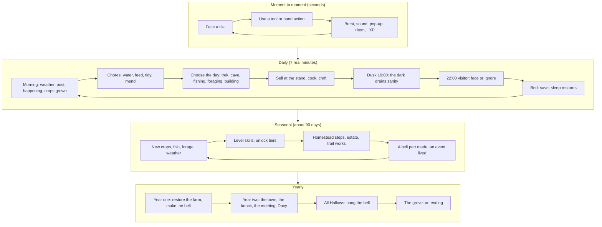

# Crow Creek Hollow: Game Design Document

**Version 1.0 (pre-production)** · November 2026 · Godot 4.7 · PC (Steam)

> Working title until October 2026: *Hallowvale*. The repository, save files and some paths still use that name.

This document describes the whole game: what it is, why it is built the way it is, and what is left to make. It is written for the team, a publisher and anyone joining the project, and is meant to be read top to bottom. The rules reference for day-to-day work is `DESIGN.md`. Where the two disagree, `DESIGN.md` holds the current tuning and this document holds the intent.

---

## Contents

1. [Overview](#1-overview)
2. [Design pillars and player experience](#2-design-pillars-and-player-experience)
3. [Story and world](#3-story-and-world)
4. [Core loops](#4-core-loops)
5. [Mechanics](#5-mechanics)
6. [Economy](#6-economy)
7. [Progression and pacing](#7-progression-and-pacing)
8. [Art direction](#8-art-direction)
9. [Audio direction](#9-audio-direction)
10. [UI and UX](#10-ui-and-ux)
11. [Achievements](#11-achievements)
12. [Technical](#12-technical)
13. [Scope and production](#13-scope-and-production)
14. [Marketing hooks](#14-marketing-hooks)

---

## 1. Overview

### At a glance

| | |
|---|---|
| **Title** | Crow Creek Hollow |
| **One-line pitch** | Keep a dead woman's farm by day; by night, keep what's under her tree from waking. |
| **Genre** | Top-down farming and life sim with psychological folk horror |
| **Platform** | PC (Windows 10/11, 64-bit) on Steam |
| **Input** | Keyboard, mouse and Xbox controller, all three at once |
| **Engine** | Godot 4.7 |
| **Rating target** | PEGI 12 / ESRB Teen: menace, dread and implied loss, no gore |
| **Length** | A two-year story of about 25 to 40 hours, then an open-ended farm |
| **Team** | Solo developer with AI-assisted art (SpriteCook) and code; music to commission |

### Elevator pitch

You inherit a run-down farm at the end of a lane, the last house before the Rookery Wood, a dark valley of fir and cedar in the Pacific Northwest. The days are a real farming game: plant through four true seasons, fish the pond, forage the field edges, mend the farmhouse room by room, keep hens and goats, and sell at a roadside stand.

At 22:00 something comes to the farm. A figure at the edge of the field. Three knocks on the door. Crows dropping onto the crops. You can go out with your lantern and face it, or bar the door and let the shadow at the far edge of the field creep one step closer to the house. When it reaches the door, the Hollow comes: a towering shape of a hundred crows.

The neighbours won't cross the wood alone any more. They come to your gate and ask you to walk them through it, with your lantern, your lamp oil and your patience, while their nerve frays and a tall thing walks between the trees. On the way, in hollow trees and through your mail slot, you find the torn pages of Agnes Rook, who kept this farm thirty years ago, rang an iron bell every night to keep the Hollow under, and walked into the wood after her husband when the town made her take it down.

Her last page asks whoever comes next to hang the bell again. It takes a year to make. The town voted it down once. In the second year, you decide how this ends.

### Genre and positioning

Crow Creek Hollow sits where the **cosy farming sim** meets **slow-burn folk horror**. The farming is complete and honest: it is the comfort the game gives, and the thing the nights threaten. The horror is never a separate mode; it is the cost of the day's choices, paid in sanity, crops and the shadow's distance from your door.

### Target audience

- **Primary:** players of cosy farming and life sims (25 to 40, PC, play in long evening sessions) who want something with more bite and a real story with an end.
- **Secondary:** fans of atmospheric, low-violence horror and narrative indies who like a mystery told through found documents and place.
- **Tertiary:** pixel-art and Pacific Northwest mood seekers: rain, woodsmoke, crows, autumn.

What they share: they like routine and growth, they read, they want to be unsettled rather than startled, and they will play the same farm for weeks.

### Comparable titles, by genre

We describe our neighbours by what they do, not by name, and we imitate none of them.

| Kind of game | What we share | Where we differ |
|---|---|---|
| Seasonal farming and life sims | Crops by season, a farmhouse to restore, animals, fishing, a roadside economy, neighbours with hearts | Every night is an encounter with a cost; the story ends; there is no town to visit, only the lane and the wood |
| Escort and guide sequences in survival games | A companion with a fear meter you must keep steady | The escort *is* the expedition system: short, hand-made routes, supplies you farm and cook, and the walker's story told on the way |
| Folk-horror narrative games | Dread through place, old rules and what the locals won't say | Played through a farming loop rather than a walk; three endings decided by a year of behaviour |
| Skill-based crafting games with old-school levels | Ten skills on a steep XP curve, gear tiers in bark, copper and iron | Skills serve the homestead and the treks rather than combat |

### Unique selling points

1. **Treks with a nervous walker.** Neighbours ask to be walked through the Rookery Wood. You keep them inside your lantern's ring, ration your lamp oil, choose the marked trail or the dark one at the fingerpost, and deal with fallen trees, floods, crow mobs, cairns of crow skulls and the tall one between the trees, all while the walker's nerve drains. If it breaks, they run.
2. **Nights as encounters.** Every night one visitor comes at 22:00. Each is a short piece of play with light and position, under a minute long. Face it and lose a little; ignore it and lose more, and the field shadow creeps toward your house, blighting crops as it goes.
3. **Agnes Rook's mystery.** Fifteen torn pages, found through things the player already does: through the mail slot, in a crow's gift, on fence wire after the first sighting, in hollow trees on the treks.
4. **The year-long crow bell.** A bell made one part a season (metal cast in winter's frost, a frame from a lightning-split oak in spring, a rope of wild flax in summer, the old clapper from the vicar who cut the first bell down) and hung only on All Hallows, a year after you arrive.
5. **Three endings.** Decided by how you treated the nights, the neighbours and the town across two years: *The Hollow Sleeps*, *Two Came Home* and *The Line Under the Rooks*.

---

## 2. Design pillars and player experience

### Pillars

| Pillar | What it means | How we test a feature against it |
|---|---|---|
| **Day is work, night is dread.** | The day is a farming shift that feels safe and productive. The night is a single encounter that costs something. | Does this feature make the day more of a comfort, or the night more of a choice? If neither, cut it. |
| **Atmosphere over jump scares.** | Horror comes from lighting, sound, silence and escalation. Nothing leaps at the camera. | Would it still work with the sound off and the screen dim? Is the scare earned by what came before? |
| **Progress carries over.** | Skills, the house, gear, the walkers' friendship and the story persist, so every session leaves the farm better. | Does the player end a session with something to show for it? |
| **Homestead first.** | The farm teaches itself: planting, gathering, repairs and light come before story or combat. | Can a new player find this through play, without a tutorial screen? |
| **The farm is the story.** | (Added in production.) Every system feeds the mystery: the bell is a building project, the pages come from chores, the endings read your nights. | Does this feature tell the player something about the Rooks, the town or the wood? |

### The emotional arc

**A day (seven real minutes).** Morning is relief: the weather, the post, the day's surprise in the yard, the crops that grew. Midday is purpose: watering, the stand, a trek if a walker waits at the gate, the cave if there's ore to find. Late afternoon tightens: the light goes warm, then thin; the crows come home to the great tree at 20:00. Dusk at 19:00 is the turn: the music gives way to wind, the ring of your lantern becomes the only safe ground. At 22:00, dread: something is here, and you choose. Bed is release, and the save.

**A season.** Each season has its own crops, fish, forage, weather and event, and each season's end is a deadline (crops still in the ground wither). Autumn, when the game begins, is cosy with a chill under it. Winter is the long dark: nights take half again, the fields are thin, and the year's dread peaks. Spring is recovery: the thaw, new crops, the orchard route opening. Summer is the safest the farm ever feels, and the only season the house can be fully restored.

**A year.** The first year is the homestead: from a cold, boarded house with one plot to a restored farm with animals, a workshop, lamp posts and three plots, ending as the crow bell's last part is made. The second year is the reckoning: the town writes to forbid the bell, the drowned orchard rises, something knocks at the door like Elias, the town votes again at the mill, and on the second All Hallows the bell is hung. One walk to the Hollow's grove decides the ending.

### Intended feelings, in order of importance

1. **Unease that never quite lets go**, even on a sunny afternoon.
2. **Care**: for the farm, the animals, the walkers.
3. **Competence and growth**: a farm that gets visibly better.
4. **Curiosity**: what happened to the Rooks, and what the town is hiding.
5. **Grief and release** at the end.

---

## 3. Story and world

### Setting

**Crow Creek Hollow** is a farm at the end of a lane in a wet, wooded valley of the Pacific Northwest. Fir, cedar and autumn oak; low cloud; rain on a tin roof; woodsmoke; crows. The farm sits between the lane, with its handful of neighbours, a mill and a chapel, and the **Rookery Wood**, a dense, dim wood that nobody crosses alone any more.

The farm itself is a single 64 by 40 tile property ringed by forest: the farmhouse, a well, a pond with a dock and an island, two plots and a fallow third, a grove of twelve trees, rocks, brush piles, a cave in the hillside on the west edge, and in the middle of the yard **the great tree**, an enormous oak that cannot be felled. The crows roost in its crown from 20:00, their eyes red in the dark.

There is no town to visit. The world is deliberately small: the farm, the cave beneath the hill, and the routes through the wood to the mill, the drowned orchard, the chapel on the hill and the Hollow's grove. Everything else arrives by post or walks up to your gate.

### Backstory

Four families kept the farm before the Rooks: the **Askews, Lindqvists, Harrows and Moores**, over sixty years. From each, one person walked out into the field one night and didn't come back.

Thirty years ago **Agnes and Elias Rook** farmed here. The crows fed something in a hollow under the great tree. **Elias** walked into it, and is still walking: a tall man with an unlit lantern, circling the drowned rows of the orchard he planted, one row for each year of their marriage. **Agnes** learned that ringing an iron bell every night kept the Hollow under. The bell was cracked and rang two notes, one for here and one for somewhere else, and when she rang it, something in the wood rang back, lower and a beat late.

The town met at the mill and voted thirty-one hands to four to have the bell taken down. The vicar cut it down while Agnes held the ladder steady. The town took the bell's value against her unpaid tax. The vicar kept the clapper. Agnes ordered new iron, wrote down everything she knew on pages she left for whoever came next, and went into the wood after Elias. The farm stood empty until you.

What the town doesn't say: it has sold the farm six times since, always cheap, always to someone from away. The farm needs a keeper so the rest of the lane needn't.

### The cast

The player character is the new owner: no name, no creator, a farmer in a straw hat, rust shirt and blue overalls. They are a stranger to the lane, which is the point.

| Character | Who they are | Role in play | Arc |
|---|---|---|---|
| **Old Maren** | An old woman with a white bun and grey shawl, visiting her sister Ruth at the mill. She was at the vote. | The first walker (the wood's edge on day 4, then the mill path from day 14). Her sister mills flour for you. | From kind neighbour to witness: Ruth wrote down every name and hand at the vote in a minute book, and Maren will stand up at a meeting if the vote is put again. |
| **Davy Tull** | A boy in a flat cap and red scarf, looking for his dog Pip, who whistles two notes like the old bell. | Walker for the drowned orchard (from spring). His mother sends apple saplings. | He has seen the man in the drowned rows and understands that someone must take a turn walking the ring for Elias to stop. In the second year he means to do it himself, and on his night the player must find him in the roots of the great tree before he goes. |
| **The vicar** | Wide hat, long face, white collar. He cut Agnes's bell down and kept the clapper. | Walker for the chapel on the hill (from summer). He gives the clapper, the bell's fourth part, and blessings that restore sanity. | Guilt. He keeps a register of the farm's owners, with a line left under the Rooks, and he struck the clapper once on the font and heard the wood ring back. His register is proof that the town hands the farm on to a keeper. |
| **The postman** | Peaked cap with a gold band, grey moustache, satchel strap. Thirty years on the round. | Walker for the postman's round (second autumn). Brings the Rooks' old parcels. | Every autumn he carries a letter to "Mrs Agnes Rook, care of the chapel", and it comes back to his sack by morning. It was he who slid Agnes's torn page through your slot on your third morning. Late on, he tells you the autumn letter is addressed in *your* handwriting. |
| **The woman in grey** | A woman in a grey shawl, only her eyes showing. She gives no name. | The last walker, to the Hollow's grove, once the bell is hung. | She is Agnes Rook. |
| **E. Pell, clerk** | The parish clerk, never seen. | Writes the land-deed letters and, in the second year, the letter forbidding the bell. | The town's voice: polite, final, afraid. |
| **Elias Rook** | Never met in person. | The man in the drowned rows; his knock at the door; his seed catalogue. | Whether he comes home is the second year's question. |
| **The Hollow** | A towering cloud of crow-black with red eyes, under the great tree. | The final night visitor when the field shadow reaches the house. | Never explained in full. It is what the crows feed, what the bell keeps under, and what took one of each family. |
| **The tall one** | A thin dark shape twice your height with red eyes, walking the trees on treks. | The treks' pursuer. It wants the walker. | Implied, never confirmed, to be connected to the Hollow and to the man in the rows. |

### Story structure

The story is told in **chapters** (shown as the current goal in the Quests panel and the diary), **Agnes's pages**, **the walkers' scenes** (four each, unlocked by friendship) and **second-year beats** that arrive on their own days. Chapters pay a small reward and open the next.

#### Act I: The homestead (year one, days 1 to about 240)

The guided first day (eight diary steps: walk, plant, open the bag, gather, open the section wheel, craft a hatchet, fell a tree, drink) teaches the farm. Then:

| # | Chapter | Goal | Story beat |
|---|---|---|---|
| 1 | Sleep Under Your Own Roof | Sleep in the bed before 03:00 | The first night's figure at the field's edge |
| 2 | Light the Way | Build a Tin Lantern | The dark has rules; light keeps you |
| 3 | To the Wood's Edge | Walk Old Maren to the wood's edge (from day 4) | The tall one's eyes in the trees; that night the Hollow is seen at the far edge of the field and comes apart into crows |
| 4 | Food Takes Time | Harvest a crop | The first turnips, about day 8 |
| 5 | The Overgrown Plot | Reach Farming 2 | The second plot opens |
| 6 | Feed Yourself Through the Cold | Harvest 10 crops | Winter is coming |
| 7 | Coin for Seed | Sell 5 items at the stand | The lane as customers |
| 8 | Something Sweeter | Harvest a pumpkin | |
| 9 | Clear the Stain | Cleanse the house | Something in the house itself |
| 10 | A Home Worth Keeping | Restore the farmhouse (summer only) | Agnes's tenth page |

Through this act Agnes's ten farm pages arrive (day 3 through the mail slot; after the first knocking; facing the field figure; holding crow feathers; the first sale; patching the house; the first sighting; the cave; the Hollow's first coming; restoring the house), and the walkers' first scenes reveal the vote, the bell's two notes, the eleven rows and the four families. The crow bell's parts are made season by season.

#### Act II: The second year (days 240 to 396)

Five beats give the bell a cost and the year a shape:

| # | Chapter | Beat | Day |
|---|---|---|---|
| 11 | The Town Writes | The parish writes that the vote of thirty-one to four stands and no bell is to be hung. Show the letter to a neighbour; each reacts in character. | 240 (late May) |
| 12 | The Water Rises | On an orchard trek the drowned orchard has risen to Elias's eleventh row. His lantern hangs dry on a branch. Davy: "He's stopped. He's looking at your farm." | from 265 |
| 13 | His Knock | The Hollow comes to the door whatever the shadow, and knocks like Elias. Faced, it leaves his thirty-year-old seed catalogue. | from 285 |
| 14 | The Meeting at the Mill | Walk Maren to the mill with Ruth's minute book and the vicar's register in hand, and the vote is put again. Otherwise the town meets without you on the Harvest Moon. | from 300 |
| 15 | Keeping Company | Davy has gone to sit in the roots of the great tree. Find him before 01:00 and talk him home. | 370 (Oct 5) |
| 16 | The Second All Hallows | Hang the crow bell | 396 (Oct 31) |

#### Act III: The grove (from day 397)

| # | Chapter | Goal |
|---|---|---|
| 17 | The Hollow's Grove | Walk the woman in grey to the grove |

The game goes on after every ending. The farm continues; the walkers keep coming; the diary gains an Afterword.

### The three endings

| Ending | Trigger | What happens |
|---|---|---|
| **The Hollow Sleeps** (the main ending) | Hang the bell on the second All Hallows and walk the woman in grey to the grove. | Agnes takes up the path behind Elias; the field shadow is gone for good. If the meeting was won, the town rings the bell with you ("thirty-one hands went up the other way"); if not, you ring alone. If Davy went in, he comes home from the grove thin and quiet and doesn't whistle now. Something in the wood rings back, two notes, lower and late. |
| **Two Came Home** (the best ending, hidden) | Walk the grove **by night**, having won the meeting (Maren's and the vicar's last scenes), seen Davy's and the postman's last scenes, and found all five of Agnes's pages from the wood. | At the grove you read the autumn letter in your own hand and step onto the ring behind Elias, and he stops. The town is ringing the bell at your farm all night in turns, so the ring needs no keeper. At first light you walk out, and Agnes and Elias walk out behind you (with Davy and Pip, if Davy went in). |
| **The Line Under the Rooks** (the dark ending, hidden) | Leave the Hollow at the door three times after day 240, before the bell is hung. | One night you walk out into the field like the four families. The postman finds you at dawn at the field's edge; the vicar writes your name on the line he left under the Rooks. It is not a game over: the save continues, the Hollow has had what it came for, the sanity it took is returned, and the bell can still be hung, so a later ending is the way back. |

Each ending plays as a short sequence over the darkened farm (title, lines one at a time, credits), then the farm returns: "Your diary has an Afterword. The farm goes on." One save can hold two endings at most (the dark ending, then one of the grove's), which is why one achievement asks for all three across saves.

### Tone and writing guidelines

- **Voice.** Plain, spare, concrete. Short sentences. The narrator states what you see and leaves the rest. "The grass at the far edge is pressed flat in a wide ring." Not: "A terrifying sight greets you."
- **Folk, not monster.** The horror is in the place, the old rules and what the neighbours won't say. Never explain the Hollow. Let the characters disagree about it.
- **No gore.** Nothing is shown hurt. Loss is implied: a seedling dies, a hen is gone in the morning, a nest of small bones in a hollow tree. Blood is never drawn.
- **Kind people, hard choices.** Nobody on the lane is a villain. The town voted from fear; the vicar cut the bell down and has carried it since.
- **The mundane carries the weight.** Seed catalogues, minute books, a register, hens descended from Agnes's. Horror lands harder next to the ordinary.
- **Agnes's pages** are first person, brown ink, practical and frightened, written for a stranger. **Your own pages** (the epilogue, the second year, the Afterword) are blue-black and quieter.
- **Words to the player** name the controls of the device in use, and are short enough to read while walking.
- **Avoid**: jokes at the horror's expense, modern slang, exclamation marks in narration, explaining a scare after it happens.

---
## 4. Core loops

The game runs four nested loops. Each feeds the one above it, and the nights and treks press down on all of them.



### Moment to moment

Face a tile and press: hoe, plant, water, harvest, chop, mine, fish, gather, talk. Every action answers with a sound in time with the animation, a puff of particles, a small camera jolt and a pop-up of what you gained. Fishing and combat are the two longer verbs: fishing holds you still on a sparkling spot while rolls tick every three seconds; combat is real-time swings and a raised guard in the cave and against trek dogs.

### Daily

1. **Morning:** the message names the weather, the post, the day's happening and any walker at the gate. Crops that were watered grew a stage overnight; rain waters everything.
2. **Chores:** water what rain didn't, feed the hens and goats (or fill their hoppers), tidy the house, mend a board when wear calls for it, mend the fence rails the storm tore. Chores done keep the "kept well" streak (coins, sanity, a crow charm every seventh night).
3. **The day's choice:** walk a neighbour through the wood (three to six game hours), mine the cave, fish the pond by season and hour, forage the edges, build and decorate, play a pastime at the desk.
4. **Afternoon trade:** the stand is open until 18:00 and wants only so much of each thing a day; cook, preserve and store the rest.
5. **Dusk (19:00):** the dark drains sanity outdoors away from light. Prepare: light torches, bar the shutters, check the coop.
6. **22:00:** one visitor. Face it in your light (lose a little, earn feathers, push the shadow back) or ignore it (lose more, the shadow creeps, crops blight).
7. **Bed (18:00 to 03:00):** saves and ends the day. Missing it by 03:00 is a collapse, with a permanent cost.

### Seasonal

Each season changes what grows, bites and comes up, and what the weather does. A season brings a dated event (Harvest Moon, First Frost, the Longest Night, Spring Thaw, the Planting Fair, Midsummer Heat, All Hallows, the Winter Feast). Skills cross levels that open crops, tools and recipes; a homestead step or two is done; one of the crow bell's parts can only be made in its season. The season's end withers what's still in the ground.

### Yearly

Year one builds the farm and the bell. Year two spends what was built, on the trail works, the estate, the land deed and the story's choices, and ends with the bell and the grove. After the ending the farm remains an open sandbox.

### The pressure loop

Nights and treks form a second loop that pushes on all of the above:

```
   skip treks ──► the wood comes closer ──► nights cost more ──► sanity falls
        ▲                                                            │
        │                                                            ▼
   short of rations ◄── crops blighted ◄── shadow creeps ◄── visitors ignored

   walk a trek ──► shadow pushed back, that night halved, a heart with the walker
```

Walking treks, facing visitors and keeping chores are what keep the farm safe. Neglect compounds; so does care.

---

## 5. Mechanics

### 5.1 Time and calendar

- **Day length:** 06:00 to 03:00 in **7 real minutes** (a game hour is 20 seconds). The longer day (raised from four minutes in October 2026) leaves room to fish, walk and explore around the chores.
- **Darkness** from 19:00. **Bed** from 18:00; sleeping saves and ends the day. **Collapse** at 03:00: the day ends, the game saves, and the sanity limit drops by 5 permanently (a cleanse wins it back).
- **Any open menu pauses the day**: the clock, needs, foes and the night's encounter all wait.
- **Calendar:** day 1 is October 1st, months have their real lengths, and the HUD shows `Day 1, Oct 1 (Autumn)`.
- **Seasons** follow the Pacific Northwest: winter December to February, spring March to May, summer June to August, autumn September to November.
- **In the wood** the clock runs slower (about 45 real seconds a game hour), so a two-minute walk costs three game hours.
- **Timed in game hours:** needs, sanity, the fire, pastimes, night beats, the trek clock. **Timed in real seconds:** fishing rolls, chopping and mining, combat, the walker's nerve, lamp oil, crows and messages. So a longer day holds more play, not more cost.

#### Seasonal events

| Event | Date | Length | Effect |
|---|---|---|---|
| All Hallows | Oct 31 | 1 day | Lanterns along the road halve the dark's cost; the only night the crow bell can be hung |
| First Frost | Nov 10 | 3 days | Warmth drains 60% faster outdoors |
| The Longest Night | Dec 21 | 1 day | The night's sanity change is doubled |
| Winter Feast | Jan 1 | 1 day | Two grilled fish and a bandage in the pack |
| Spring Thaw | Mar 1 | 2 days | Watered crops grow an extra stage |
| Planting Fair | Apr 20 | 1 day | Five turnip seeds |
| Midsummer Heat | Jun 21 | 3 days | Every day is sunny |
| Harvest Moon | Sep 22 | 1 day | Two turnip hashes and +10 sanity; in year two the town meets |

### 5.2 Weather and seasons

Weather is rolled each morning from the season's weights and holds all day. Seven kinds (sunny, overcast, foggy, drizzle, rain, downpour, snow), each with its own cloud cover, wash, edge darkening, particles and light colour.

| Season | Typical weather | Average temperature |
|---|---|---|
| Autumn | Cloudy, drizzle and rain, the odd sunny or foggy day | 54°F |
| Winter | Wet: downpours, fog, rare snow | 40°F |
| Spring | Cloudy, drizzle and rain, the odd sunny or foggy day | 51°F |
| Summer | Mostly sunny, a few cloudy or foggy days | 67°F |

- **Temperature** = the season's average, a daily swing of about 7°F (coldest at dawn), and the weather (sun +6, fog −2, drizzle −3, rain −4, downpour −6, snow −10).
- **Rain waters every crop** (drizzle, rain, downpour), including those planted that day.
- **Storms** tear fence rails loose (two after a downpour), and some downpour mornings bring thunder.
- **Seasonal particles:** autumn leaves, spring petals, summer fireflies at dusk; rain streaks with splashes, snow, fog wisps and passing cloud shadows.

### 5.3 Farming and crops

Eleven crops, each with the seasons it grows in. Planting out of season is refused; a crop still in the ground when its seasons end withers the next morning, with warnings three days ahead and on the last day. Turnips grow all year so trail rations always have their staple.

| Crop | Seasons | Farming | Days | Yield | Regrows | Sells | Seeds (catalog) | Keeps in cellar |
|---|---|---|---|---|---|---|---|---|
| Turnip | all year | 0 | 7 | 1 | | 9 | 5 for 15 | yes |
| Kale | autumn, winter | 1 | 6 | 1 | every 5 days | 7 | 5 for 20 | |
| Peas | spring | 1 | 6 | 2 | every 3 days | 5 | 5 for 15 | |
| Corn | summer, autumn | 2 | 8 | 2 | | 13 | 4 for 24 | |
| Potato | spring, summer | 2 | 8 | 3 | | 8 | 4 for 20 | yes |
| Leek | winter, spring | 2 | 9 | 1 | | 18 | 4 for 28 | yes |
| Pumpkin | summer, autumn | 3 | 10 | 2 | | 19 | 3 for 30 | |
| Parsnip | winter, spring | 3 | 9 | 2 | | 15 | 4 for 32 | yes |
| Strawberry | spring, summer | 4 | 8 | 1 | every 4 days | 12 | 3 for 42 | |
| Garlic | autumn, winter | 4 | 12 | 2 | | 24 | 3 for 36 | yes |
| Blueberry | summer | 5 | 10 | 2 | every 5 days | 13 | 2 for 50 | |

- **Growth:** a crop grows overnight only if it was watered that day; unwatered crops wait, and the morning message counts them. Four visible stages: sprout, leaves, swelling fruit, ripe.
- **Seed back:** most crops that don't regrow return a seed half the time; regrowers rarely do.
- **Plots:** plot one (15×7) is tilled from the start; plot two (15×6) opens at Farming 2; plot three (12×6) at Farming 9 once the house is Patched.
- **Threats:** the field shadow's blight sets back the crops nearest it; the night crows peck crops back a stage; at house wear 6 or more, rain ruins a crop overnight. Scarecrows keep crows off within 4 tiles.
- **Why:** seasons give the year its rhythm and make the cellar, preserves and planning matter. The withering deadline turns each season's end into a small decision.

### 5.4 Watering

Watering is the farm's first constraint and its first upgrade path.

| Stage | How | Unlock |
|---|---|---|
| Bucket | One crop a press from a bucket of 8; refill at the pond | From the start |
| Pump and tank | Repair the well's pump; a tank of 40 refills each morning | 6 wood, 4 fiber, Carpentry 2 |
| Hose | One crop a press from the tank, anywhere on the farm | 3 fiber, 2 resin |
| Copper nozzle | Three crops in a line a press | 6 copper bars, 2 fiber, Smithing 3 |
| Spray head | The 3×3 ahead a press | 10 copper bars, 2 iron bars, Smithing 6 |
| Copper cistern | The tank holds 64 | 40 copper bars, 4 iron bars, Smithing 5 |
| Sprinkler (up to 12) | Waters the 8 tiles around it each dry morning, from the tank | 5 copper bars, 1 iron bar, Smithing 4 |
| Spray sprinkler (up to 6) | The 24 tiles in a 5×5 | 15 copper bars, 3 iron bars, Smithing 8 |

Each crop still costs one water, so the tank limits how much can grow on a dry day. **Why:** the cave's copper and iron need a reason to exist on a farm, and watering is the chore every player feels; easing it is the most satisfying reward we can give.

### 5.5 Animals

| | Hens | Goats |
|---|---|---|
| Building | Coop: 6 wood, 4 fiber, Carpentry 2 | Barn: 10 wood, 6 fiber, Carpentry 7 |
| Price (catalog) | 12 coins, up to 4 | 45 coins, up to 3 |
| Feed | 1 crop each a day | 2 crops each a day |
| Grown after | 7 nights | 10 days |
| Produces | 1 egg a morning when fed (sells 3) | 1 milk a morning when fed (sells 6) |
| Sells for | 20 grown | 70 grown |
| Neglect | Two unfed days and it wanders off | The same |

- **Feed hoppers** (coop: 4 wood, 4 copper bars, Carpentry 3; barn: 6 wood, 6 copper bars, Carpentry 7) hold 30 crops and feed overnight if you didn't.
- **Raids** threaten them at night (see 5.14). A lamp post or torch lighting the building halves raids and drives them off while you sleep.
- **Why:** eggs and milk are worth little at the stand by design. Their value is in trail rations, bread, chowder and pies: animals exist to make treks possible.

### 5.6 Foraging

Each morning 2 forageables (one more per three Bushcrafting levels, up to 5) come up on open grass beside the farm's trees; each trek clearing has 2 more. Yesterday's go over. No tool is needed; each gives 8 XP plus 3 per level the find needs.

| Forage | Seasons | Bushcrafting | Sells | Used in |
|---|---|---|---|---|
| Stinging nettles | spring | 1 | 2 | nettle soup |
| Fiddleheads | spring | 1 | 3 | fiddlehead fry |
| Salmonberries | spring, summer | 1 | 3 | berries |
| Blackberries | summer, autumn | 1 | 3 | berries |
| Rose hips | autumn, winter | 1 | 2 | rose hip tea, tincture |
| Chanterelles | autumn | 2 | 7 | mushrooms |
| Yellowfoot | winter | 2 | 5 | mushrooms |
| Huckleberries | summer | 3 | 4 | berries |
| Oyster mushrooms | winter, spring | 3 | 6 | mushrooms |
| Morels | spring | 4 | 10 | mushrooms |
| Ghost pipe | summer, autumn | 5 | 14 | ghost pipe tincture |

### 5.7 Fishing

Face one of the sparkling spots on the pond edge and press to cast. While you keep still, a roll comes every 3 seconds: a 50% chance plus 3% a level, capped at 90% (each rod adds 10%). A spot lives 15 to 30 seconds, then a new one appears. Three spots, a fourth at Fishing 3 and a fifth at Fishing 5.

| Fish | When | Fishing | Sells | Notes |
|---|---|---|---|---|
| Yellow perch | all year, any hour | 1 | 6 | always bites |
| Bluegill | summer, day | 1 | 5 | |
| Cutthroat trout | spring and autumn, day | 2 | 10 | garlic trout |
| Black crappie | winter and spring, any hour | 2 | 8 | the winter fish |
| Brown bullhead | summer and autumn, night | 3 | 9 | bullhead fry |
| Lamprey | winter and spring, night | 4 | 12 | unsettling raw; smoked lamprey |
| Pale carp | all year, after 22:00 | 5 | 26 | landing one costs 3 sanity |
| White sturgeon | all year, day | 6 | 45 | sturgeon steak |

Raw fish **spoil overnight** in the pack; the cooler keeps 10. **Why:** fishing by hour and season rewards staying out late, and the pale carp is a deliberate temptation to fish when the visitors come.

### 5.8 Cooking and preserving

Cooking is a skill. Recipes are cooked at the fire (the Craft panel's Cooking tab); inputs can be groups (*fish (any)*, *berries (any)*, *mushrooms (any)*), spent cheapest first. Foods restore food, sanity and HP by difficulty and level; some have effects: **warm**, **water**, **calm** (extra sanity) and **nerve** (steadies a walker on a trek).

| Dish | Needs | Level | Sells | Effect |
|---|---|---|---|---|
| Grilled fish | 1 fish, 1 wood | Cooking 0 | 8 | |
| Turnip hash | 2 turnips, 1 wood | 0 | 8 | |
| Baked potato | 1 potato, 1 wood | 1 | 9 | +10 warmth |
| Rose hip tea | 3 rose hips, 1 wood | 1 | 8 | +15 warmth, +20 water, +4 calm |
| Nettle soup | 2 nettles, 1 wood | 1 | 10 | +10 warmth, +15 water |
| **Trail ration** | 1 egg, 1 turnip, 1 wood | 2 | 10 | steadies a walker (+35 nerve) |
| Pea soup | 3 peas, 1 wood | 2 | 12 | +15 warmth |
| Fiddlehead fry | 2 fiddleheads, 1 egg, 1 wood | 2 | 14 | |
| **Farmhouse bread** | 2 flour, 1 egg, 1 wood | 3 | 14 | the fallback ration (+50 nerve) |
| Pumpkin soup | 2 pumpkins, 1 wood | 3 | 12 | +10 warmth |
| Fish stew | 1 fish, 2 turnips, 1 wood | 3 | 13 | +10 warmth |
| Colcannon | 2 potatoes, 1 kale, 1 milk, 1 wood | 3 | 18 | +10 warmth |
| Leek and potato soup | 1 leek, 2 potatoes, 1 wood | 3 | 20 | +25 warmth, +10 water |
| Roast roots | 2 parsnips, 1 turnip, 1 wood | 3 | 22 | +15 warmth |
| Bullhead fry | 1 bullhead, 1 corn, 1 wood | 3 | 16 | +10 warmth |
| Corn chowder | 2 corn, 1 potato, 1 milk, 1 wood | 4 | 24 | +20 warmth |
| Forager's stew | 2 mushrooms, 1 leek, 1 wood | 4 | 22 | +25 nerve, +10 warmth |
| Garlic trout | 1 trout, 1 garlic, 1 wood | 4 | 26 | +6 calm |
| Apple crumble | 2 apples, 1 flour, 1 wood | 4 | 22 | +8 calm |
| Hearty stew | 1 smoked fish, 2 turnips, 1 wood | 5 | 20 | +15 warmth |
| Pumpkin pie | 1 pumpkin, 1 flour, 1 egg, 1 wood | 5 | 30 | +10 calm |
| Berry cobbler | 3 berries, 1 flour, 1 egg, 1 wood | 5 | 30 | +10 calm, +15 nerve |
| Ghost pipe tincture | 1 ghost pipe, 2 rose hips, 1 wood | Bushcrafting 5 | 40 | +20 calm, +40 nerve |
| Sturgeon steak | 1 sturgeon, 1 garlic, 1 wood | 6 | 80 | +20 warmth, +10 calm |

**The smokehouse** (60 coins, 5 wood, 3 fiber, Carpentry 4, in the workshop) preserves food that never spoils:

| Method | Input | Makes | Sells | Skill |
|---|---|---|---|---|
| Smoke a fish | 1 fish, 1 wood | Smoked fish | 11 | Cooking 2 |
| Dry turnips | 2 turnips | Dried crops | 9 | Farming 2 |
| Can turnips | 2 turnips, 1 fiber | Canned turnip | 10 | Cooking 3 |
| Ferment turnips | 2 turnips, 1 wood | Fermented turnip | 11 | Cooking 4 |
| Make jam | 3 berries, 1 fiber | Bramble jam | 10 | Cooking 2 |
| Dry mushrooms | 2 mushrooms | Dried mushrooms | 12 | Cooking 3 |
| Smoke a lamprey | 1 lamprey, 1 wood | Smoked lamprey | 34 | Cooking 4 |

**Storage:** the root cellar (30 crops of the kinds that keep; 80 of any kind with the cellar room) and the cooler (10 fish) are built from the House panel. **Why:** the stand's daily demand makes raw surplus worth less with every sale; cooking and storing turn it into rations, gifts and better goods.

### 5.9 Crafting and gear

The Craft panel is a picture grid in sub-tabs (gear, tools, cooking and other). Each tile shows what it needs, dimmed until you can make it.

**Gear** fills a paper-doll of ten slots: Back (bag), Head, Neck, Belt (lantern), Off hand (shield), Chest, Main hand (weapon), Wrist, Legs and Feet. Bark gear (Bushcrafting) comes first; copper (Smithing 2 to 3) and iron (Smithing 5 to 6) replace it slot by slot.

| Slot | Bark tier | Copper | Iron |
|---|---|---|---|
| Head | Resin cap (+1) | Copper helm (+2) | Iron helm (+3) |
| Neck | Twine collar (+1), resin amulet (+2) | Copper torc (+2) | Iron torc (+3) |
| Chest | Bark wrap (+2) | Copper cuirass (+3) | Iron cuirass (+4) |
| Main hand | Sharpened stick (2 damage), hunting knife (3) | Copper sword (4) | Iron sword (6) |
| Wrist | Fiber wraps (+1) | Copper bracers (+2) | Iron gauntlets (+3) |
| Legs | Reed leggings (+1), bark greaves (+2) | Copper greaves (+2) | Iron greaves (+3) |
| Feet | Bark boots (+1) | Copper boots (+2) | Iron sabatons (+3) |
| Off hand | Hardwood shield (Forestry 4) | Copper shield (Smithing 3) | Iron shield (Smithing 6) |

**Tools** are kept by tier: hatchets (crude, stone, copper, iron; copper or better for hardwood), picks (stone, copper, iron; copper or better for iron ore), rods (willow at Fishing 2, hardwood at Fishing 5, +10% each) and the hose heads.

**Lanterns** light a ring in the dark. They are the most important item in the game:

| Lantern | Ring | Needs | Bushcrafting |
|---|---|---|---|
| Tin Lantern | 2.5 tiles | 4 wood, 3 fiber | 2 |
| Brass Lantern | 4 tiles | 4 wood, 4 fiber, 2 resin | 4 |
| Hollow Lantern | 6 tiles, flickers | 6 wood, 6 fiber, 4 resin | 6 |

**Other:** bandages (2 fiber, 1 resin; heal 25 HP), rope (2 fiber, Bushcrafting 3; for floods), crow charms (4 feathers, 1 stick; halve one night's sanity loss).

**Bags** add pack slots to a 20-slot start (stacks of 28): satchel (+10, 40 coins, Carpentry 1), haversack (+10, 120 coins, Carpentry 3), backpack (+10, 300 coins, Carpentry 5).

### 5.10 Skills and progression

Ten skills, each from level 1 to 10, on a steep, old-school curve. Levels 1 to 5 cost 50 × (L−1) × L XP in total; past level 5 each level costs 1.8 times the last. The **Hale** state (food, water and warmth all at 70 or more) adds 20% to every XP gain.

| Level | 2 | 3 | 4 | 5 | 6 | 7 | 8 | 9 | 10 |
|---|---|---|---|---|---|---|---|---|---|
| Total XP | 100 | 300 | 600 | 1,000 | 1,720 | 3,016 | 5,349 | 9,548 | 17,106 |

| Skill | Trained by | Key unlocks |
|---|---|---|
| **Farming** | Planting (5), each harvest (12 to 45 by crop) | Crops at 1 to 5; plot two at 2; plot three at 9 |
| **Bushcrafting** | Brush piles (15), lanterns (25), crafting gear and tools (10), forage, torches and snares, treks (60 to 300 a walk) | Lanterns, gear, rope, thickets at 3, reading the fingerpost at 3, trek routes at 4 and 5 |
| **Carpentry** | House repairs (30), mending a board (20, three a day), anything with a wooden part (8), fence rails (20), scarecrows, shutters | Pump, repairs, buildings, bags, extensions, the bell frame |
| **Cleaning** | The daily tidy (20) | +3 sanity per tidy at 2; the cleanse at 3 |
| **Cooking** | Each recipe (10 to 40) | Recipes by level |
| **Fishing** | Each catch (15, +5 a level the fish needs) | Fish by level, spots at 3 and 5, rods |
| **Forestry** | Felling trees (20), splitting firewood, fallen branches | Hardwood shields |
| **Mining** | Rocks and cave ore (8 each) | Copper at 2, iron at 5 |
| **Smithing** | Smelting a bar (20), forging | Copper and iron gear and tools, hose heads, sprinklers, the cistern, lamp posts, bell metal |
| **Combat** | Each hit (4), kills (12 to 18) | Max HP (10 + level − 1), bonus damage |

**Pace:** in the balance sim Bushcrafting 2 (the Tin Lantern) comes on day 1, Carpentry 2 (the pump) on day 5, Farming 10 around day 86, and the other skills reach 10 between then and the second autumn. Smithing climbs about a level a week once the furnace stands, held back by the furnace's eight bars a day. **Why** the steep curve: every skill has a quick, visible early ramp and a long tail that lasts the two years.

### 5.11 Body needs

| Need | Drain | Restored by |
|---|---|---|
| **Food** | About 2.4 an hour (empty in two days) | Any food: 10 + 12 × difficulty + 3 × level |
| **Water** | About 3 an hour, 1.6× on hot days (75°F and up) | The pond (+40), the pump (+35), soups and tea |
| **Warmth** | Below 50°F outdoors, faster when colder | Indoors by a lit hearth, sleeping with the fire lit, warm foods |

An empty need costs 1 HP every two hours. **Firewood** is split at the chopping log (1 wood makes 2 firewood) and burned in the hearth, 3 hours a log, up to 12. With the fire out, the house is as cold as outside. **Why:** needs are light by design. They make the house a shelter and give food a second purpose; they never become a survival grind.

### 5.12 Sanity and its tiers

Sanity runs from 0 to a maximum of 100. The maximum drops 5 with each collapse and each Hollow left at the door, and can be won back.

| Change | Amount |
|---|---|
| Outdoors in the dark, away from light | −0.91 a game hour (×1.5 in winter, ×1.15 in autumn) |
| Indoors | +0.46 a game hour, +0.69 once Boarded |
| Tidying | +3 (+3 more at Cleaning 2) |
| A night with every chore done | +2 |
| Sleep | +8, plus 0.2 per point under 60 |
| The day's first pastime | +3, and 2 lost limit back |
| Flower beds, furniture, the porch | +1 to +2 each every morning |
| A night visitor | −4 to −30 before multipliers (see 5.13) |

A typical day gives back about 25; a summer night takes 9 to 44, a winter night twice that (capped at 45 for one visitor). So winter and skipped treks wear you down, and spring lets you recover. The sleep bonus under 60 means a run of bad nights settles into a trough rather than a spiral.

**Low sanity changes the world**, in three tiers. None costs anything by itself; each tells you how far gone you are.

| Tier | What happens |
|---|---|
| **Under 60** | Crows sit on the roof and tree tops by day with their heads turned toward you; footsteps behind you by day |
| **Under 40** | A figure at the edge of the screen, gone if you walk toward it; once a day the tool in your hand isn't the one you picked up; knocking at the door; the animals cry out at night |
| **Under 30** | The whole screen darkens |
| **Under 20** | The HUD lies (the clock shows the wrong hour); a ripe pumpkin stands on an empty plot until you come near ("You're sure there was."); the door opens on its own; under 15 the music falls silent and your own heartbeat takes over |

**The way back:** waking under 20, the vicar is at the gate (at most once a week) offering a blessing for 3 crops for the poor box: +30 sanity, 5 limit back, and that night's losses halved. The cleanse (Cleaning 3, 2 crops, once a day) lifts the limit by 5.

### 5.13 Nights and encounters

At 22:00 one visitor comes. **Facing it** costs a little sanity, leaves crow feathers and pushes the field shadow back. **Ignoring it** (waiting until 01:00, or going to bed, even early) costs more and lets the shadow creep. Each encounter is under a minute of play with your **light** (the lantern's ring, or arm's length without one; a lamp post or torch holds at half strength) and **where you stand**. The first three times you meet each one, its messages say what to do.

| Visitor | Comes | How to face it | Faced / ignored (before multipliers) |
|---|---|---|---|
| **The figure at the field's edge** | from the start | Hold it in your light until it fades; twice it slips back into the dark and must be found again | 4 sanity, 1 feather / 10 |
| **The knocking** | from the start | Indoors, stand by the door to hold it shut each time the latch rattles (three times); outdoors, hold the knocker in your light | 5, 1 feather / 12 |
| **A quiet night** | from the start | Nothing to answer: the crickets and the wind fall silent | 3 |
| **The crows** | after 7 nights | Three crows drop onto crops one at a time; light each in time or it pecks that crop back | 4 and a feather each / 7 and crops pecked |
| **The pond lights** | after 7 nights | Press as they swell brightest; three right answers it | 5 and two fish / 8 |
| **The tall watcher** | after 7 nights | Hold it in light, but while lit it steps toward you; back away as it comes or it lunges | 10, 2 feathers, shadow back 2 / 20 |
| **The footsteps** | after 14 nights | Pale prints circle closer in the dark; reach the house or a lamp's light and outlast them | 4 / 18 |
| **The Hollow** | when the shadow reaches the house | Held like the field figure but longer, slipping away and lunging | 20, 5 feathers, shadow to the far edge / 30, −5 limit, 4 crops blighted, shadow back halfway |

- **Scripted nights:** the **first night** (day 1) is always the same short scare that teaches the dark, sanity and the bed. The **first Hollow sighting** (the night of the walk to the wood's edge, or day 9) shows the Hollow at the field's far edge, looking only at the house, coming apart into crows; it leaves Agnes's seventh page on the fence wire.
- A **strike** (a missed hold, a lunge, a wrong press) costs 3. A lost encounter counts as ignored.
- **Multipliers:** every night loss is ×2.2 at base; winter ×1.5, autumn ×1.15; the Longest Night ×2; All Hallows ×0.5; a crow charm ×0.5; a trek that day ×0.5; the wood come close ×1.25; the bell ×0.75; the second storey ×0.9; the grove walked ×0.75. Shutters halve the knocking.
- **Why:** nights are a choice, not a tax. A player who faces them earns feathers and safety; a player who hides pays in sanity and crops. Both are valid, and the endings read both.

### 5.14 Raids

From the seventh night, once there are hens or goats, some nights at 23:00 something comes for the animals: a **fox** at the coop door, **crows** on the coop roof, or **something low at the barn door**. The chance is 12% a night, +12% at house wear 4, +2% a shadow step and +3% a torn fence rail, halved by a light at the spot. Get there and light it within a game hour. Lost: a hen, the next morning's eggs, or the milk (and a goat at wear 4). Asleep, a raid is lost unless a lamp post or torch lights the spot.

### 5.15 The field shadow and blight

The shadow starts at the far east edge of the field. Each ignored or lost visitor moves it **4 tiles toward the house**; each faced one moves it back. Each step it creeps kills the grass it crosses and reaches for the 2 crops nearest it (each wilts back a stage; seedlings die), leaving a line of dead grass that fades over 6 days. **After 8 steps it reaches the house, and the Hollow comes.**

Twelve days without a trek (from the first winter) and the wood comes closer: crows line the north fence, every night costs a quarter more, and the shadow creeps a step every night until someone is walked. **Why:** the shadow writes the player's neglect across the farm, where they see it every morning.

### 5.16 The Hollow

The Hollow is the game's antagonist and is never explained. It appears four ways: the **first sighting** in the first week; at the **door** whenever the shadow arrives; **knocking like Elias** in the second year; and at the **crow bell** on the second All Hallows, one last time. While the bell stands, the shadow stops a step short of the house and the Hollow no longer comes. After the grove, it sleeps for good.

### 5.17 Treks

**The premise:** since Agnes's bell came down, nobody crosses the Rookery Wood alone. Neighbours come to the gap in the trees on the farm's north edge and ask to be walked.

**How a trek plays.** Talk to a walker at the gap (before 15:00) and set out with your lantern, lamp oil and food. Each route is a chain of hand-made **clearings**: long, switchbacking trails through dense wood, dim even by day. You walk faster than the walker (3.75 tiles a second against 2.6), so you keep stopping for them.

- **Nerve** (0 to 100, starting at 70) drains every second: slowly inside your light, fast outside it, faster off the trail, more when you are far ahead, when your own sanity is under 40, or when crows mob them. **Under 25 they freeze** until fed; **at 0 they run**: the trek ends, the supplies are spent, and you lose 10 sanity. Restore nerve with a **trail ration** (+35), **farmhouse bread** (+50) or **a word** (+10, once a clearing, with a line of their story).
- **Lamp oil:** a flask burns 75 seconds; the mill path takes about two. Without oil the lantern goes out, and the dark is where nerve goes.
- **The fork:** after the first clearing an old fingerpost offers the **marked trail** (longer, gentler, pale blazes on the trunks) or the **dark trail** (shorter, darker, harsher events, better pay). Which arm is which changes daily; the sign reads at Bushcrafting 3.
- **The tall one** walks the trees from the second clearing: a thin shape twice your height, only its red eyes showing outside your light, coming straight for the walker. Lift the lantern at it within 3 tiles to drive it off. If it reaches them, their nerve drops 30.
- **Dread:** the wood learns you. Each trek finished raises its dread by one, up to 6: nerve wears faster, the tall one is quicker and bolder, crows need driving off more often, and the pay rises.
- **Night treks** (chapel and grove, from 18:00): double pay, double sanity drain and a faster tall one.

**Events** (one per clearing, picked by day and season; summer skips the flood and the fog; each season makes two events likelier):

| Event | The choice |
|---|---|
| **Fallen tree** | Cut through with a hatchet (wood), or take the way round off the trail (nerve) |
| **Crows** | Drive them off from beside the walker, three times (sanity for feathers) |
| **Flooded hollow** | Tie a rope across, or wade with the walker on your back (warmth, far more in winter; nerve) |
| **Lights off the path** (dark trail) | Follow them (half the time a shortcut, otherwise lost an hour), or keep to the trail while they wear on nerve |
| **Cairn of crow skulls** | Leave 5 coins or a ration (sanity and nerve back), or walk past and upset the walker |
| **Fog bank** (dark trail) | A Brass Lantern burns a way through; otherwise wait while the oil burns |
| **Hollow tree** | Reach in: feathers, old coins, a nest of small bones, or one of Agnes's pages from the wood |
| **Feral dogs** (orchard, chapel, grove) | Fight them with the sword, or hurry past |

**Routes:**

| Route | Walker | Opens | Clearings | Needs | Pays |
|---|---|---|---|---|---|
| The wood's edge (once) | Old Maren | Day 4 | 2 short | A Tin Lantern (she brings the oil) | 10 coins, 2 fiber, 25 XP; the story's hook |
| The mill path | Old Maren | Day 14 (Oct 14) | 3, the marked trail longer | A lantern, 1 oil | Seeds, feathers, fiber, 60 XP; the mill buys corn |
| The drowned orchard | Davy Tull | Spring (day 152) | 5 marked / 4 dark | Bushcrafting 4, 2 oil | 120 XP, hardwood, flax in summer; buys eggs and milk |
| The chapel on the hill | The vicar | Summer (day 244) | 6 / 5 | Bushcrafting 5, 2 oil | 200 XP, lamp oil, storm oak in spring, the bell's clapper; buys pumpkins and fish |
| The postman's round | The postman | Second autumn (day 336) | 5 / 4 | Bushcrafting 5, 2 oil, by day | 160 XP, a crow charm |
| The Hollow's grove (once) | The woman in grey | After the bell is hung (day 397) | 7 / 6 | Oil (more by night), rations | 300 XP, five feathers; the ending |

**Arriving** pays seeds, feathers, fiber and Bushcrafting XP (not coins), and the destination buys some of what you carry at a quarter over the stand's price, up to 8 items. Coming home pushes the field shadow back a step and halves that night.

**Walker standing:** once a walker knows you (3 hearts for Maren and Davy, 2 for the vicar and the postman), each walk brings a gift only they give: Maren's sister's **flour**, Davy's mother's **apple saplings**, the vicar's **blessing** (+10 sanity, limit back) and the postman's **parcels** addressed to the Rooks.

**Trail works** (Buildings, Trail works tab) make treks safer and are the big coin goals of year one:

| Work | From | Coins | Materials | Effect |
|---|---|---|---|---|
| Waymarks | day 14 | 150 | 10 wood | The fingerpost reads without Bushcrafting |
| The mill footbridge | day 14 | 300 | 12 wood, 6 rope | Floods on the mill path are dry |
| A lamp at the gate | day 14 | 400 | 2 iron bars | Walkers come twice as often |
| The mill handcart | day 14 | 600 | 30 hardwood, 10 iron bars | Destinations buy 6 more a walk |
| The orchard boardwalk | spring | 700 | 20 wood, 8 rope | The orchard is a clearing shorter |
| Oil tins at the stiles | spring | 900 | 40 copper bars, 4 iron bars | A flask lasts 110 seconds |
| The waystation hut | summer | 1,200 | 30 wood, 10 hardwood | A rest halfway: nerve and warmth refill |
| The chapel steps | summer | 1,800 | 30 stone, 4 iron bars | The chapel by night without the doubled drain |
| Lamps on the post road | second autumn | 1,500 | 16 iron, 30 copper bars, 20 hardwood | Walkers set out with nerve 90 |

**Why treks:** they are the game's signature. They make sanity matter by day, give the farm's eggs and turnips a purpose (rations), give coins a destination (oil, works), train Bushcrafting, tell each walker's story on the way, and carry the mystery into the wood. A careful bot arrives at the mill in about 95 seconds with nerve no lower than 66; a careless walk breaks in the second clearing. People react more slowly than the bot, so expect closer calls.

### 5.18 The cave, mining and smithing

- **Farm rocks** (eight spots, back every 14 days): by hand 1 stone; with a pick 2 stone and 8 XP; from Mining 2 a 15% chance of copper ore.
- **The cave** in the hillside on the farm's west edge is laid out fresh each day and is pitch dark without a lantern. About 9 copper and 3 iron nodes a day (iron only deeper, with a copper pick and Mining 5). Three bats, two lizards and two snakes: ordinary animals, never supernatural, so the cave is the one place to fight without dread.
- **Combat** is real time: a swing reaches 1.5 tiles in an arc (0.5 s cooldown); holding block turns blows from the front. Foes flash pale when hit; there are no health bars. Damage is the weapon's plus up to half your Combat level; armor reduces hits to a minimum of 1. Losing all HP sends you home with a 10 sanity penalty.
- **The furnace** (80 coins, 6 wood, 4 stone, Carpentry 5, in the workshop) smelts 3 copper ore or 2 iron ore with a wood into a bar, at most 8 bars a day.
- **Where metal goes:** gear, tools, hose heads, the cistern, sprinklers, hoppers, lamp posts, the extensions, the trail works and the bell metal.

### 5.19 The homestead ladder

Fourteen visible steps in the Buildings section, with the next one named. Each pays 20 coins. They can be done in any order; their levels and seasons pace them across the first year.

| # | Step | Balance sim day (engaged) |
|---|---|---|
| 1 | Board up the house | 1 |
| 2 | Open the second plot | 6 |
| 3 | Build the coop | 6 |
| 4 | Patch the house | 11 |
| 5 | Build the smokehouse | 18 |
| 6 | Build the firewood store | 19 |
| 7 | Build the furnace | 32 |
| 8 | Light the yard (a lamp post) | 61 |
| 9 | Open the third plot | 63 |
| 10 | Build the barn | 78 |
| 11 | Make the Hollow Lantern | 109 |
| 12 | Plant four flower beds | 156 |
| 13 | Restore the house (summer only) | 244 |
| 14 | Hang the crow bell (the second All Hallows) | 396 |

**The farmhouse** has four stages, each changing the outside, every room inside and what it opens:

| Stage | Cost | Opens |
|---|---|---|
| Decrepit | (the start) | The hall and bedroom: bed, desk, hearth |
| Boarded | 3 wood, 2 fiber, Carpentry 1 | Better sanity recovery indoors |
| Patched | 5 wood, 4 fiber, Carpentry 3 | The parlor (the daily tidy) and the land deed's letter |
| Restored | 8 wood, 6 fiber, Carpentry 8, summer only | The study, a porch lamp that holds the dark, softer nights |

**Wear** rises a point a night (every other night when Restored) and a point for each chore left undone, up to 10. Mending takes 2 off, a tidy 1, a repair 3. At wear 4 raids rise; at 6 rain ruins crops.

The workshop (a walled 7 by 6 building placed wherever the player likes) holds the furnace, smokehouse, firewood store and chopping log. The coop and barn are placed and moved freely too.

### 5.20 Decor

Placed from the Buildings section's Decor tab on open grass; most can be taken down for their materials. The newest pieces (October 2026) let early players prepare for the night with what they gather, before metal and lamp posts.

| Piece | Cost | Needs | Effect |
|---|---|---|---|
| **Torch** (up to 12) | 1 stick, 1 fiber, 1 resin | Bushcrafting 2 | A one-night lamp with a 2-tile ring: stops the dark's drain, guards a coop or barn, keeps crows off. Burns out by morning |
| **Snare** (up to 4) | 2 sticks, 2 fiber | Bushcrafting 2 | Each morning may hold a hare (40%; a food that sells for 12), two crow feathers (15%), or a crow's skull picked clean (7%: a feather, −3 sanity) |
| **Scarecrow** (up to 4) | 3 wood, 2 sticks, 3 fiber | Carpentry 2 | Crows won't settle on crops within 4 tiles, by night or day |
| **Window shutters** (one) | 6 wood, 2 sticks, 2 fiber | Carpentry 3 | From 18:00, bar them for the night (+10 Carpentry XP): the knocking takes half |
| **Torn fence rails** | 1 wood, 1 stick to mend | | Storms tear rails each morning (more after downpours and while the shadow is near); each adds 3% to raids. Mending gives 20 Carpentry XP |
| Lamp post (up to 8) | 3 wood, 1 iron bar | Smithing 7 | A permanent 3-tile ring after dusk; guards animals while you sleep |
| Flower bed (up to 6) | 1 wood, 2 turnip seeds | Farming 2, planted in spring or summer | +1 sanity every morning except in winter |
| Gravel path | 1 stone a tile | | Grass to path, laid in runs |
| Wattle fence (up to 300) | 2 sticks, 1 wood a tile | | Joins the fences beside it |
| Apple tree (up to 6) | 1 sapling (from Davy) | Farming 4 | An apple each autumn morning |
| Sprinklers | see 5.4 | | Watering |
| Garden bench, birdbath, weathervane | Hardwood, stone, copper, iron, coins | | The look of the farm |
| **Crow bell** (one) | The bell metal, frame, rope and clapper, 20 feathers, 150 coins | Carpentry 6, hung on All Hallows only | The shadow stops short of the house; the Hollow no longer comes; every night takes a quarter less |

**The crow bell's parts**, one a season:

| Part | Needs | When |
|---|---|---|
| Bell metal | 4 iron bars, 2 copper bars, 10 crow feathers, Smithing 6, the furnace | Winter only (it cools in the frost) |
| Bell frame | 1 storm oak, 6 hardwood, Carpentry 6 | Storm oak from a spring happening or the chapel trek |
| Bell rope | 9 wild flax, 2 resin, Bushcrafting 5 | Flax from a summer happening or the orchard trek |
| The old clapper | Given by the vicar on a chapel trek | From summer |

A game starts on October 1st, so the bell can't be hung before the second All Hallows (day 396). **Why** a year-long project: it gives the whole first year a visible goal that sends the player into every system (the furnace, the wood, the happenings, the walkers) and ends on the most charged night of the calendar.

### 5.21 The estate and the land deed

Long goals once the homestead stands, so there is always a next thing to save for.

| Extension | Needs | Cost | Effect |
|---|---|---|---|
| **Cellar room** | Patched, the root cellar | 700 coins, 60 stone, 20 hardwood, 20 copper bars, Carpentry 5 | The cellar holds 80 crops and keeps every kind |
| **Covered porch** | Patched | 1,200 coins, 60 wood, 40 hardwood, 40 copper bars, Carpentry 6 | The stand takes a quarter more a day; +2 sanity each morning |
| **Second storey** | Restored, the porch | 3,000 coins, 100 wood, 80 hardwood, 60 stone, 60 copper, 20 iron, 60 feathers, Carpentry 8 | +6 sanity from each sleep; nights take a tenth less |

**Furniture** (+1 sanity every morning each): oak dresser 150, feather bed 250, armchair 200, long-case clock 350, a painting of the farm 400 and a bookshelf for the study 300 (each with hardwood, feathers or metal too). **Paint** (six colours, 200 a coat) and **wallpaper** (five patterns, 150) change the house's look.

**The land deed:** the morning after the house is Patched, the town clerk writes that the farm is held from the town on the quarter's tax, that the town took Agnes's bell in lieu when she fell behind, and that the deed can be bought outright for **12,000 coins**, paid 500 at a time. Once it is paid no tax comes again, and a last letter tells what became of her bell. It is where spare coins always have somewhere to go.

### 5.22 Folk and friendship

The four walkers are neighbours as well as escorts.

- **Hearts:** 0 to 10 each (20 points a heart). The first three walks give a heart each, later walks 4 points (8 more by night); the day's first word 1; a gift 10 if loved, 5 if liked, 2 if neutral, −8 if disliked (one a week each); a request done 20.
- **Farm visits:** on days nobody waits at the gate, one day in two a walker comes by from 09:00 to 16:00: Maren by the stand, the postman at your door, Davy skimming stones at the pond, the vicar under the great tree. They come before their routes open, so you know them before you walk them.
- **Scenes:** four each, at 2, 4, 6 and 8 hearts, at least 10 days apart, played in the dialogue box with portraits. The last scene of each is a hook for the second year and the endings.
- **Requests:** three each, by hearts and season (six eggs for the mill, three perch for Davy, a white sturgeon for the harvest supper, six firewood in winter...).

| Walker | Loves | Dislikes |
|---|---|---|
| Old Maren | rose hip tea, bramble jam, apple crumble | pale carp, lamprey, ghost pipe |
| Davy Tull | strawberries, salmonberries, pumpkin pie, berry cobbler | kale, nettle soup, parsnips |
| The vicar | pumpkin soup, sturgeon steak, chanterelles, fish stew | pale carp, lamprey, fermented turnip |
| The postman | corn chowder, smoked lamprey, hearty stew | bramble jam, rose hip tea, strawberries |

### 5.23 Daily happenings

From day 2, one surprise a day, never the same twice running, announced in the morning and gone by the next:

| Happening | What it gives |
|---|---|
| **Pedlar** (by the stand, until 18:00) | Sells one odd thing: a crow charm, seeds, a sudoku book, feathers |
| **A glint in the grass** | Coins, feathers tied with red thread, a seed tin, or a warm tin soldier (−5 sanity, +15 coins) |
| **A fallen branch** | 3 wood, 1 hardwood, Forestry XP |
| **The crows' gifts** under the great tree | Coins and a feather (three times as often after the grove) |
| **A mushroom ring** (rarer) | Usually food and sanity; sometimes −10 sanity and a feather |
| **Fish frenzy** | The day's catch chance +25% |
| **A neighbour's gift** | Eggs, hash, kindling or coins, with a line about the farm |
| **Storm oak** (spring) | The bell frame's oak, with a hatchet |
| **Wild flax** (summer) | The bell rope's flax |

A **daily job** at the House panel also asks for a few of one kind of thing (crops, fish, wood, stone, resin, forage, cooked food or preserves) for coins and XP.

### 5.24 The post and the desk

Post comes through the mail slot and lands on the bedroom **desk**, whose red light blinks while letters are unread. The Desk panel has four tabs: **Post** (letters and deliveries), **Tax** (the bill and the land deed), **Pastimes** (solitaire, 1 hour, and sudoku, 1.5 hours; they pass the time rather than being played out, and the day's first gives +3 sanity and 2 lost limit back) and **Catalog** (seeds, hens, goats, lamp oil, cards and puzzle books, delivered with the next morning's post). Nothing that can be gathered is sold. The **diary** is found in the desk drawer on the first day.

### 5.25 Property tax

A bill arrives on the 1st of January, April, July and October (not on day 1), due in 14 days. It is the farm's **property value**: 50 coins, ×1.8 per house stage, ×(1 + 5% per building + 15% per extension), ×(1 + 25% per plot past the first), plus 3 a hen, 8 a goat and 4 a lamp post or sprinkler. A new farm pays about 60 a quarter, a restored one about 750, one with all three extensions about 950.

Unpaid: a reminder the day after it's due, a final notice 7 days late, and at 14 days late **the land is lost** and the save is deleted. This is the only true fail state, and it is slow, loud and avoidable. Buying the deed ends tax for good.

---

## 6. Economy

### Philosophy

Coins should always be **a little short and always have somewhere to go**. A cosy farming game's economy usually breaks by mid-year: the player has more money than wants. Ours is built around three ideas:

1. **The lane only wants so much.** The farm stand pays full price for a day's demand, then less with every sale. A spread of crops, cooking and storage beat a field of one thing.
2. **Animals feed treks, not the purse.** Eggs and milk sell cheaply; their worth is in rations, bread and recipes.
3. **Big, visible sinks at every stage.** The catalog and furniture early, the trail works and cellar room in the first winter, the porch and summer works in year one, the second storey and the land deed in year two.

### Sources

| Source | Notes |
|---|---|
| **The farm stand** (06:00 to 18:00) | Buys only what you carry. Full price for **15 of each crop, 2 eggs, 1 milk, 6 fish, 3 forage and 2 cooked foods** a day (fish, forage and cooked are each pooled); past that each sale pays less, down to 30% by the time as many again are sold. Demand recovers each morning. The covered porch raises every demand by a quarter. |
| **Trek trade** | Each destination buys some of what you carry at 1.25× the stand's full price, ignoring demand, up to 8 items a walk (14 with the handcart): the mill buys corn, the orchard eggs and milk, the chapel pumpkins and fish. Turnips are never bought: they are the rations' staple. |
| **Animal sales** | A grown hen 20, a grown goat 70 |
| **Chores** | The kept-well streak pays 1 coin a night of the streak, up to 8; tidy and mend finds |
| **Happenings and requests** | Purses, the crows' gifts, request rewards (15 to 80 coins) |
| **The daily job** | Coins and XP for a delivery |
| **Homestead steps** | 20 coins each |

### Sinks

| Sink | Scale |
|---|---|
| Seeds | 15 to 50 a pack |
| Lamp oil | 8 a flask; 1 to 3 a trek |
| Animals | 12 a hen, 45 a goat |
| Buildings | 25 (root cellar) to 80 (furnace) |
| Bags | 40, 120, 300 |
| Trail works | 150 to 1,800 each; 7,550 for all nine |
| Furniture, paint, wallpaper | 150 to 400 each |
| Extensions | 700, 1,200, 3,000 |
| The crow bell | 150 coins and the parts |
| Property tax | About 60 to 950 a quarter |
| The land deed | 12,000, in 500s |

### Price tables

**Crops:** turnip 9, kale 7, peas 5, corn 13, potato 8, leek 18, pumpkin 19, parsnip 15, strawberry 12, garlic 24, blueberry 13. Each crop's first harvest pays at least twice its seed cost (turnip 9 for a 3-coin seed, pumpkin 38 for 10, garlic 48 for 12); strawberries and blueberries pay back over their regrowing.

**Animal goods:** egg 3, goat milk 6.

**Fish:** perch 6, bluegill 5, crappie 8, bullhead 9, trout 10, lamprey 12, pale carp 26, sturgeon 45.

**Forage:** rose hips and nettles 2; salmonberries, blackberries and fiddleheads 3; huckleberries 4; yellowfoot 5; oyster mushrooms 6; chanterelles 7; morels 10; ghost pipe 14.

**Cooked and preserved:** 8 (grilled fish, hash, tea) to 80 (sturgeon steak); preserves 9 to 34 (see 5.8). A hare from a snare sells for 12.

**Catalog:** pack of cards 10, sudoku book 12, lamp oil 8, hen 12, goat 45, seeds per 5.3.

### Balance targets

| Target | Why |
|---|---|
| Coins in the **low thousands** for most of year one, never a pile | There is always something worth saving for |
| A **next thing to buy** at every point | Catalog and furniture early; cellar room and porch from the second week; trail works from day 14; the second storey and summer works once restored; the deed throughout |
| **No material over a few hundred** by day 400 | Copper, iron and hardwood each have sinks; nothing piles up unused |
| **The land deed and all three extensions done in year two** | The late game has a long goal |
| **Facing the nights is the safer choice** | Sanity bottoms higher for players who face visitors than for those who hide or sleep early |
| **No one loses sanity limit** in a normal year | Collapses and the Hollow are the only permanent costs, and both are avoidable |

### Balance sim results

The balance sim plays a new game day by day through the real game functions, in three styles: **engaged** (faces the nights, does the chores, walks 3 treks a week), **ignore** (does the chores, ignores the visitors) and **earlybed** (goes to bed before 22:00). These are the current results across the October and November 2026 tuning passes.

| Measure | Engaged | Ignore | Earlybed |
|---|---|---|---|
| Coins through year one | about 150 to 2,500 | about 250 to 2,100 | about 250 to 2,100 |
| Coins at day 420 (second year act) | 341 | 873 | 1,783 |
| Lowest sanity in the year | 26 | 16 | 9 |
| Days under 60 / 40 / 20 sanity | 11 / 2 / 0 | 88 / 10 / 2 | 66 / 19 / 5 |
| Vicar's blessings taken | 0 | 0 | 4 |
| Grove walked | day 399 | day 399 to 400 | day 399 to 400 |
| Ending reached | Two Came Home (399) | The Line Under the Rooks (290), then The Hollow Sleeps (407) | The Line Under the Rooks (283), then The Hollow Sleeps (399) |
| Achievements by day 420 | 38 to 40 of 60 | 29 | 28 |

**Where an engaged player's money went in year one** (economy pass, 400 days): income from crops 6,323, forage 4,152, eggs and milk 4,138, cooked food 3,570 and trek trade 1,824. Spent on the estate 10,900 (cellar room day 102, porch day 140, all six furniture pieces, paint, wallpaper and 7,000 of the deed, begun on day 38), trail works 6,050, tax 2,357, seeds 2,012 and oil 960.

**Materials at day 400:** copper bars 355 to 427, iron bars 327 to 354, hardwood 226 to 311, stone about 345, sticks 186 to 301, feathers 81 to 208 (with 145 to 234 crow charms made).

**Year two** (engaged, 730 days): the second storey on day 481, the land deed owned on day 598. After that coins rise to about 4,500 by day 730 and copper, iron and hardwood build up again. This is the known gap in the late economy (see 13, Risks).

**History, for context:** before the economy pass, 400 days ended with about 41,000 coins in every mode, eggs and milk earning 20,000 a year. The demand curve, cheaper animal goods, harder smelting, rarer hardwood and the estate brought that down to the targets above.

---

## 7. Progression and pacing

### The first hour

The first hour must show the horror, since a demo depends on it.

| Real time | Day | What happens |
|---|---|---|
| 0:00 | 1 | Wake in a decrepit house. The diary waits in the desk drawer; its red light blinks. |
| 0:02 | 1 | The guided first day (eight diary steps): walk, plant 3 turnips, open the bag, gather 3 brush piles, open the section wheel, craft a crude hatchet, fell a tree, drink from the pond. |
| 0:05 | 1 | Chapter 1: sleep under your own roof. |
| 0:07 | 1 | **The first night** at 22:00: the crows fall silent, footsteps or three knocks, then the figure at the field's edge. A whisper teaches sanity, the bed and the lantern. |
| 0:08 to 0:20 | 2 to 3 | Chapter 2: build a Tin Lantern. Board the house. Day 3: Agnes's first page through the mail slot, and word that Old Maren will come. |
| about 0:25 | 4 | **The walk to the wood's edge**: two short clearings, a fallen tree, the tall one's eyes in the trees, Maren's hook about the vote at the mill. |
| about 0:30 | 4 | **The first Hollow sighting** that night: every crow goes up; the Hollow stands at the far edge of the field, looking only at the house, then pours into the great tree's roots. Agnes's seventh page is caught on the fence wire. |

### The first week

The first turnips ripen around day 8. The second plot opens at Farming 2 and the coop goes up about day 6. Farm visits begin (Maren from day 5, the postman from day 6). Night visitors widen after night 7 (crows, pond lights, the tall watcher), and raids begin if there are hens. The house is patched about day 11. The diary's notes arrive as each system is met: watering, food and water, sleep, repairs, quests, chores, buildings, the mine.

### The first season (autumn, to day 61)

The mill path opens on day 14 and the first mill trek comes around day 21. Waymarks, the footbridge and the gate lamp are built (days 22 to 55). The smokehouse, firewood store and furnace stand by day 32. Maren's first scenes (the lamp in the mill window, Agnes's hens). The first tax bill on January 1st is still a season away; the land deed letter arrives once the house is patched. First Frost (November 10) is the first hard season event.

### Year one

| Season | Days | Shape |
|---|---|---|
| Autumn | 1 to 61 | The homestead: house boarded and patched, coop, workshop, the mill path |
| Winter | 62 to 151 | The long dark: nights take half again, the wood starts coming closer after 12 days without a trek, lamp posts and the third plot, the barn, the Hollow Lantern, **the bell metal** (winter only) |
| Spring | 152 to 243 | Recovery: the orchard route and Davy, Spring Thaw, **storm oak** for the bell frame, flower beds |
| Summer | 244 to 335 | The safest season: **restore the house** (summer only), the chapel route and the vicar, **wild flax** for the rope, the clapper |

### Year two

The postman's round opens on day 336. The town's letter (day 240) has already begun the second-year act, which runs through the meeting and Davy's night to **the second All Hallows (day 396)**, when the bell is hung. The grove opens the next day. The second storey and the land deed finish in year two.

### Onboarding

- **No tutorial screens.** Everything the game teaches is written in the diary, so nothing covers the play area.
- **The guided first day:** eight steps, each written out in full when it's next, with "Done" and a chime. Steps done early are passed over.
- **Notes** arrive as the player reaches each part of the farm (watering, needs, sleep, repairs, quests, chores, buildings, the mine, hens, goats, the cellar, smelting, the Rookery Wood).
- **The current chapter** is always one page in the diary and the top of the Quests panel.
- **Encounters teach themselves:** each night visitor's messages say what to do for the first three meetings. Walkers explain nerve, light and words when asked.
- **Controls are named for the device in use** in every message.

### Difficulty curve

```
 pressure
   ▲                          ┌─ Longest Night
   │                  ┌───────┘  winter ×1.5
   │                 ╱            the wood comes closer
   │      night 8   ╱                         second-year act
   │     ┌─────────┘                       ┌────────────┐  All Hallows
   │ first night                    summer │            │  ▲
   │  ▲  sighting      spring  ╲___________│            └──┘ grove
   │──┴──┴──────────────────────────────────────────────────────────►
     d1  d4   d14    d62        d152       d244      d336     d396
```

- **Days 1 to 7:** only three gentle visitors; scripted scares that cost little.
- **From night 8:** the full visitor set, raids.
- **From night 15:** the footsteps.
- **Winter (day 62):** the multipliers peak; the wood starts coming closer; the tall one has learned you (dread rises with each trek).
- **Spring and summer:** relief, unless the player has let the shadow creep.
- **Second year:** the act's beats add story pressure rather than raw difficulty; the knock and the meeting are tests of what the player built.

There is no difficulty setting yet; see Open questions.

---

## 8. Art direction

### The locked style

| Rule | Detail |
|---|---|
| **Chunky 16 px pixel art** | Every sprite is drawn at 16 pixels per tile and shown at 3×, nearest-neighbour. One art pixel is always three screen pixels; nothing is resampled to fit. |
| **Whole-tile sizes** | Characters 16×32 (two tiles); props and buildings in multiples of 16 (the farmhouse 192×160, the well 32×48). |
| **Straight-on 3/4 top-down** | Fronts face the camera. No isometric or angled views. |
| **Muted Pacific Northwest palette** | Mossy greens, weathered browns, grey stone, rust and ochre; desaturated even before the grade. |
| **Dark outlines** on every sprite | So silhouettes read over any ground, at night, in rain. |
| **Horror through lighting, not gore** | The art itself is never gruesome. Menace comes from the night tint, red eyes, silhouettes and what the light doesn't reach. |

The **style anchor** is the chunky farmhouse study; new sprites use it as a reference.

### Colour grade and lighting

- **The grade** (a full-screen pass under the HUD): saturation down to 62%, the scene darkened to 84%, a little contrast, faint warmth in the highlights and cold blue-grey in the shadows, a heavy vignette and fine film grain. The grass is tinted darker and mossier. The HUD stays unfiltered so text is sharp.
- **Night** is a cool, shadowy tint. Light sources (the lantern's ring, lamp posts, torches, the hearth, the restored porch lamp, the chapel window) cut through it. Visitors carry a faint red glow at eye height (pale blue for the pond), so their outline and eyes read in the dark.
- **The crows' eyes** in the great tree glow red through the night tint.
- **The cave** has no daylight: pitch black without a lantern, a faint cool glow at the exit by day.
- **The wood** is dim by day and darker on the dark trail, lighter in summer and darker in autumn and winter.
- **Low sanity** darkens the whole screen under 30.
- **Weather** has its own cloud cover, wash, edge darkening and light colour.

### UI skin

One SpriteCook UI kit: **dark wood frames with iron corner brackets**, wooden buttons (normal, hover, pressed, disabled), framed slots with a gold edge when selected, parchment cards, and bar frames for the needs (tan food, blue water, orange warmth). Drawn as 9-slices. Text colours are fixed: titles and highlights in gold, body in cream, notes and hints in muted tan. All HUD and message text has a dark outline. The diary is a leather book with parchment pages and ribbon markers.

### Characters and creatures

| Subject | Design language |
|---|---|
| **The farmer** | 16×32, straw hat, rust shirt, blue overalls. Readable, warm, ordinary: the one sure thing in the frame. |
| **The walkers** | Same scale and outline as the farmer. Each has one strong silhouette cue: Maren's bun and shawl, Davy's cap and red scarf, the vicar's wide hat and collar, the postman's peaked cap and satchel. |
| **Portraits** | 48×48 busts, shown at 2×, in five expressions (neutral, smile, worry, grim, far). The woman in grey shows only her eyes. |
| **Animals** | Hens and goats on short walk cycles, gentle and slightly comic: they are what the player protects. |
| **Cave creatures** | Bats, lizards, snakes: real animals, small and quick, never monstrous. |
| **Night visitors** | Silhouettes first. Tall, thin, dark, with red eyes; never detailed faces, never limbs doing anything specific. The less drawn, the better. |
| **The Hollow** | A towering cloud of crow-black with red eyes; it comes apart into crows. Its edges should move. |
| **The tall one** | A thin dark shape twice the farmer's height; only its eyes outside the light. |
| **Crows** | Everywhere, always watching. A perched sprite and a four-frame flight cycle. |

### Animation rules

- The farmer has 8-frame idles and walks facing down, up and right (left mirrors right), and a sheet per tool action (hoe, water, plant, chop, mine, swing, cast) in three directions. The tool only shows while it is used.
- Animals and foes animate on four frames; a foe animates while it moves and turns pale when hit.
- **Game feel** adds weight: particles of one or two art pixels (dirt, droplets, leaves in the season's colours, chips, stone, sparks), a camera jolt on each tool strike and a harder one for felling and breaking, and floating pop-ups for XP, coins and items.
- Seasonal particles (leaves, petals, fireflies) and weather (rain streaks with splashes, snow, fog, cloud shadows) follow the camera and stay small in number.
- Nothing animates faster than it needs to. Stillness is part of the horror: the watcher doesn't move until lit.

### Asset list and status

**Done in SpriteCook (final style):**

| Area | Assets |
|---|---|
| Farmer | Base, idles, walks (3 directions), 7 tool action sheets (21 sheets) |
| Farmhouse | 4 exterior repair stages; interior floors (old, new), walls, beds (4 quilts), hearth (5 states), dresser and desk, rug, mat, table, chairs |
| Ground | 5 dual-grid tilesets: grass, path, soil, fallow, water |
| Trees and nature | Oaks, firs, willows, dead trees, stump, the great tree, boulders, brush piles, thicket, ground clutter, mossy hillside |
| Crops | Turnip, corn, pumpkin (4 stages each) |
| Buildings | Coop, barn, workshop, root cellar, smokehouse, furnace, firewood store, chopping log, well, fence |
| Cave | Mouth, exit, floor, walls, copper and iron ore |
| Creatures | Crows (perched, flight), hen and goat walks, bat, lizard, snake |
| Weather | Rain drops and splashes, snow, leaves, petals, fog, cloud |
| UI | The UI kit (frames, buttons, slots, bars, banner, parchment), 52 item icons, minimap icons, section wheel icons |

**Code-drawn placeholders (to replace):**

| Area | Assets |
|---|---|
| Crops | Kale, peas, potato, leek, parsnip, strawberry, garlic, blueberry (8 strips of 4 stages) and their pack icons |
| Walkers | Maren, Davy, the vicar, the postman, the woman in grey (sprites with walks) |
| Portraits | 23 portraits (4 walkers × 5 expressions, the woman in grey × 3) |
| Night | The field figure, the knocker, the tall watcher, the footprints, the pond lights, the Hollow, the tall one |
| Trek | Feral dogs, fallen logs, the fingerpost and stile, floods, cairns, fog banks, hollow trees, the four destinations (mill with turning wheel, drowned orchard, chapel, the grove's ring of trunks) |
| Decor | Lamp post, torch, snare, scarecrow, shutters, torn rails, flower bed, sprinklers, apple tree, bench, birdbath, weathervane, wattle fence, the crow bell |
| Estate | Cellar doors, porch, second-storey dormer, furniture pieces |
| Yard | Pedlar, glints, fallen branch, mushroom ring, forage (11 kinds) |
| Trail works | Nothing is drawn for them yet |
| UI | Diary book and its icon, tab planks, prompt glyphs (A, B, LB, RB, L3, Q, E, Space, Esc, Shift), tab icons |
| Store and Steam | 120 achievement icons (60 earned, 60 locked), the game icon, capsule art |

### Art backlog, in priority order

1. **Night visitors and the Hollow.** The horror's face; the first thing a demo shows.
2. **Walker sprites and portraits.** They carry the story and the treks.
3. **Trek props and destinations,** starting with the mill path (logs, fingerpost, stile, the mill).
4. **The game icon, capsule and store art.** Needed for the Steam page.
5. **The remaining eight crop strips** and their icons.
6. **Night-prep decor:** lamp post, torch, scarecrow, shutters, snare (seen every evening).
7. **The crow bell** and its post.
8. **Feral dogs** (animated, to match the cave creatures).
9. **Yard happenings and forage.**
10. **Estate extensions and furniture.**
11. **Remaining decor, prompt glyphs and tab art.**
12. **Achievement icons** (120).
13. **Trail works drawn** on the farm and in the wood.

---

## 9. Audio direction

### Principles

- **Silence is a tool.** The score drops out at the most frightening moments, so the music never has to do the scaring alone.
- **Lo-fi, worn, analog.** Small acoustic ensembles recorded as if in a cold room to old tape: soft attacks, a little wow and flutter, rolled-off highs.
- **Folk horror, not stock horror.** No orchestral hits, trailer braams, EDM or choirs singing words.
- **The day must be easy to live with.** Players hear the day themes for hours.

### The music director

One track plays at a time, chosen by what is happening, crossfading over three seconds. Highest priority first:

1. The title screen
2. An ending's lines and credits
3. A night visitor (its stinger, then the dread loop; the Hollow has its own pair)
4. A trek, with a tense layer faded in over it while the walker's nerve is under 40 or the tall one is out
5. The cave
6. **Silence** on a "too quiet" night and under 15% sanity
7. The farmhouse: a gentle track by day, **silence** after dark
8. Outdoors from 19:00: the night track
9. Outdoors by day: the season's theme

An open menu lowers the music by 6 dB without stopping it. Stingers duck the music 10 dB. The ambience beds dip up to 3 dB under the music.

### Tracks

| Track | Priority | Plays | Mood | Suggested key and instruments |
|---|---|---|---|---|
| Title | Core | Title and slot menu | An old photograph of the farm; beautiful, sad, something wrong at the edge | D minor; music box, pump organ, distant bowed saw |
| Spring | Core | By day, March to May | Thaw, cautious hope | G mixolydian; fingerpicked guitar, wooden flute |
| Summer | Core | By day, June to August | The safest the farm ever feels | C lydian; banjo or guitar, felted piano |
| Autumn | Core | By day, September to November | Rain, woodsmoke, harvest; cosy with a chill | A dorian; old upright, fiddle, muffled lo-fi kit |
| Winter | Core | By day, December to February | Cold, sparse, lonely | E minor; celesta or hand bells, cello |
| Night | Core | Outdoors from 19:00 | Watched from the trees; still, never loud | B phrygian; low drone, sparse whistle, bowed metal |
| Trek | Core | Walking a neighbour | Careful steps, a steady pulse | C# minor; guitar ostinato, cello drone, frame drum |
| Trek (tense) | Core stem | Layered over Trek | Danger closing in | Same key, dissonant; tremolo, col legno, heartbeat |
| Cave | Core | The mining cave | Deep, dripping, the mountain's weight | E-flat phrygian; drone, bowed metal, kalimba drips |
| Hollow | Core | The Hollow at the door or its sighting | Awe and terror, ritual | F phrygian clusters; tolling bell, detuned organ |
| Ending | Core | Ending lines and credits | Grief and release; the farm goes on | D dorian resolving to major; the title theme returning |
| Hearth | Extra | The farmhouse by day | Shelter, a kettle | F major; felted piano or nylon guitar alone |
| Dread | Extra | A night visitor, after its stinger | Something is out there | B-flat phrygian; cello drone, heartbeat |

**Stingers:** a visitor appearing (held breath, then a jolt), the Hollow appearing (something enormous waking), a page of Agnes's found (discovery, a little sadness), an achievement (small, warm), and **the crow bell ringing for the first time** (triumph that sounds ancient and costly: a real tolling bell, three strikes).

**Status:** every track has a seeded synthesized stand-in at the right loudness, so a commissioned file drops straight in. The composer brief specifies OGG at 44.1 kHz, loops at −18 LUFS and stingers at −16, seamless loop points, and the trek stems sample-locked. The bare minimum commission is six tracks (title, autumn, night, trek, cave, Hollow); the core set is ten.

### Sound effects

Every action has a short, physical sound, built from filtered noise, struck wood and metal partials, plucked notes and formant voices, with a short room or outdoor reverb, and random pitch per play. Tools sound on every swing in time with the animation; a tree falls with a crack, a rush and a thud. Fighting has swings, thuds, blocks and each foe's call. Chores have their own (casting, feeding, splitting, smelting, sweeping). Moments have theirs: a hollow gust entering the cave, a falling lullaby at sleep, a boom and pounding heart at collapse. Night events: a dread swell, three slow knocks, and the crickets falling silent.

**Philosophy:** sounds are physical, never beepy, with a bright bite on top so they carry on laptop speakers. They are levelled to one loudness and every one can be replaced by a file of the same name.

### Ambience layers

| Place | Beds | Occasional sounds |
|---|---|---|
| **Outside** | A breeze by day giving way to a cold night wind; crickets at night outside winter and heavy rain; rain at three strengths; a low dread drone rising with the dark, low sanity and fog | Crows by day; at night an owl, a branch snapping, something howling far away; at low sanity, slow footsteps behind you and whispering; thunder |
| **The farmhouse** | Still cold air, wind through the boards (louder at night), rain on the roof and window, the hearth crackling | Floorboards and beams creaking, the house groaning as it settles |
| **The cave** | A heavy hollow drone, air breathing through the tunnels, the dread drone under it | Dripping water, claws on stone, trickling pebbles, moaning tunnels, the mountain rumbling |

Under a quarter of your sanity you hear your own heartbeat, faster the lower it goes.

### The mix

Three buses: **Music**, **SFX** (which includes ambience) and master. Music and SFX each have a volume in Settings (0 mutes). The ambience beds dip under the music; the music dips under stingers and menus. Night is the quietest time in the game by design: when the visitor's stinger hits, it has room.

---

## 10. UI and UX

### HUD layout

| Position | Element |
|---|---|
| Top left | Date and season, time, weather, temperature; coins; sanity (`current/max`); the diary icon ("New" with a red dot when a page is unread) |
| Under the top bar | Food, water and warmth meters (red under 25), the gold **Hale** tag; the walker's nerve on treks |
| Top right | Minimap (the farm, brush, the player, the shadow on event nights), in the panel's rail |
| Bottom centre | The hotbar: ten framed tool slots, the active tool's name in gold underneath; the dialogue box sits above it |
| Bottom left | Messages, outlined so they read over any ground |
| Bottom right | The bag button and a small Menu button for mouse players |
| Floating | Pop-ups over the farmer for XP, coins and items |

The game is laid out for 1280×720 and scales to fill the window; a window of another shape shows more of the world rather than black bars.

### Menus

- **The section wheel** (Shift, left-stick click, or the Menu button): a ring of the eight sections not in the bag: Skills, Gear, Craft, Quests, Diary, House, Buildings, Achievements. Choose one and it opens alone, full screen. B returns to the wheel.
- **The bag** (Tab or Y): a 4-wide grid of 20+ slots, the name of the focused slot in gold under it, and an Inventory button.
- **Ledger panels** (House, Buildings, Desk, Quests, Achievements, Settings, Pause and every small panel): tabs switched with LB/RB or Q/E; a list of one-line entries on the left with a coloured status (green ready, rust short, grey done, gold information); the focused entry's detail page on the right with its needs ticked or crossed, a progress bar and the action button. Every entry takes focus; the list wraps.
- **Picture grids** (Inventory, Gear, Skills, Craft): tiles four across with a detail card beside them; the first press on a recipe jumps to its Make button so a second press makes it.
- **Amount entries** (selling, storing, taking): left and right step the count from 1 to all; the detail shows "3 of 12, for 41 coins".
- **The diary book:** a two-page spread with ribbon markers per section (First day or The farm asks, Notes, Agnes Rook, The wood, The second year, Afterword). Turn pages with left and right or the wheel; jump sections with LB/RB.
- **The dialogue box:** portrait, name in gold, words in cream; scenes page with Space or A.
- **The footer** shows button prompts (Select, Close, Tabs, Sections) in keyboard or Xbox names, following whichever device was used last, relabelling in place.
- **Any open menu pauses the day.**

### Input maps

| Action | Keyboard | Mouse | Xbox controller |
|---|---|---|---|
| Move | WASD or arrows | | Left stick or D-pad |
| Hand action (talk, sleep, gather, open, drink, place) | Space | | A |
| Tool or weapon | | Left click | RT |
| Block | | Right click | LT |
| Hotbar | 1 to 0 | Wheel, or click a slot | LB / RB |
| Cycle seed (trowel in hand) | Z / X | | D-pad up / down |
| Bag | Tab | Bag button | Y |
| Section wheel | Shift | Menu button | Left-stick click |
| Diary | J | Wheel section | Wheel section |
| Pause | Esc | | Start |
| Close / back | Esc | Close button | B |
| Menu focus | Arrows or WASD, Enter or Space | Hover and click | D-pad or left stick, A |
| Tabs | Q / E | Click a tab | LB / RB |
| Turn a diary page | Left / right, A / D | Wheel, corner arrows | D-pad or left stick |

Keyboard, mouse and controller all work at once; prompts follow the last device used.

### Accessibility

**In now:**
- Music and sound-effect volumes (0 to 100% in tens; 0 mutes), fullscreen or windowed, window sizes, **screen shake on or off**, and **message duration** (short, normal, long).
- Readable text: outlined HUD text, fixed colour roles, text that steps down a size then ellipsises rather than overflowing.
- Full controller support everywhere, with nothing disabled in the focus path.
- **The hints system:** the diary's guided first day, notes and chapter pages; each night visitor's instructions for the first three meetings; walkers who explain the trek when asked.
- Any menu pauses the game; the scariest moments are short and never require fast reflexes.
- **Unstick me** in the Pause menu moves the player to open ground.

**Planned for 1.0:** key and button rebinding; a text-size option; **subtitles or captions for important sounds** (knocks, footsteps, whispers, the heartbeat), since much of the horror is heard; a colour-blind check of the status colours and the red-eye cues; an option to reduce flicker (the Hollow Lantern, the screen darkening); and a gentler mode for the nights (see Open questions).

### Saving

- **Three save slots**, each with a name (default "Farm N"), listed with day, coins and house stage.
- **The game saves only when you sleep** (or collapse at 03:00). Quitting mid-day loses the day; the quit buttons say so and need a second press.
- **Crash-safe:** each save is written to a temporary file, read back and checked, then moved over the real file; the previous save becomes a backup. A damaged save is recovered from its backup and the start screen says so.
- **Versioned and migrated:** each save records its version, and older saves are lifted one version at a time.
- **Eviction** for unpaid tax deletes the save and its backups, by design.

---

## 11. Achievements

Achievements mark the moments the game is about rather than counters: the story's acts and endings, the wood, the nights, the walkers, the farm's long goals and a few secrets. There are **60** in six groups; **12** are hidden (shown as "???" until earned, and hidden on Steam). They pay **no in-game rewards**, so there is nothing to farm and nothing that distorts play. Earning one plays a small music-box chime.

Each has a Steam API name, a display name, a description, a hidden flag and an earned and locked icon (not drawn yet). The list is exported for Steamworks as a CSV. **Every Way It Could Go** counts endings across all saves on the machine, since one save can hold two at most.

### Story (10)

The acts, the pages and the endings.

| Achievement | How | Hidden |
|---|---|---|
| **The First Year** | Finish the first ten chapters, up to A Home Worth Keeping. |  |
| **Whoever Has This Farm Next** | Find all ten of Agnes Rook's torn pages about the farm. |  |
| **His Knock** | Face the Hollow when it knocks at your door like Elias. | yes |
| **Thirty-One Hands** | Have the vote on the bell put again at the mill, and win it. |  |
| **Not Your Turn** | Find Davy Tull in the roots of the great tree before he goes. | yes |
| **The Second All Hallows** | Finish every story chapter. |  |
| **The Hollow Sleeps** | Reach the ending The Hollow Sleeps. |  |
| **Two Came Home** | Reach the ending Two Came Home. | yes |
| **The Line Under the Rooks** | Reach the ending The Line Under the Rooks. | yes |
| **Every Way It Could Go** | Reach all three endings, in any of your saves. |  |

### The wood (9)

The treks through the Rookery Wood.

| Achievement | How | Hidden |
|---|---|---|
| **To the Wood's Edge** | Walk Old Maren to the edge of the Rookery Wood. |  |
| **The Arm With the Crow** | Take the dark trail at the fingerpost, and arrive. |  |
| **After Dark in the Rookery** | Set out with a walker after 18:00, and arrive. |  |
| **Every Way Through** | Walk Maren to the mill, Davy to the orchard, and the vicar and the postman to the chapel. |  |
| **Left in the Hollow Trees** | Find all five of Agnes's pages from the wood. |  |
| **Round and Round** | Walk the woman in grey to the Hollow's grove. |  |
| **The Wood Knows You** | Walk the wood until its dread is at its height. |  |
| **Nothing in the Pack** | Walk someone past the wood's edge without giving them a ration or a loaf. |  |
| **Darker Than the Dark** | Take the dark trail by night, and arrive. | yes |

### Nights (14)

The visitors, the raids, the seasons and sanity.

| Achievement | How | Hidden |
|---|---|---|
| **Something Walks This Farm** | Live through your first night. |  |
| **Hundreds of Them** | See the Hollow at the far edge of the field. |  |
| **Like Smoke** | Hold the thing at the field's edge in your light until it thins away. |  |
| **Hold the Door** | Hold the door shut while the latch rattles. |  |
| **Not One Crop** | Drive the crows off your crops in the night. |  |
| **Something Cold** | Reach into the pond on the lights' third swell. |  |
| **Taller in the Light** | Face the tall figure watching from beside the house. |  |
| **Don't Look Back** | Outlast the footsteps behind you, indoors or in a lamp's light. |  |
| **A Hundred Crows** | Hold the Hollow in your light at your own door until it comes apart. |  |
| **Not Tonight** | Catch something at the coop or the barn in your own light. |  |
| **All Through the Long Dark** | Keep every hen and goat you have through a whole winter. |  |
| **Only a Field** | Grow crops through a whole season without the shadow blighting one. |  |
| **Back From Under** | Let your sanity fall under 20, and bring it back above 60. |  |
| **Into the Dark** | Face fifty things that come in the night. |  |

### Folk (8)

The four walkers as neighbours.

| Achievement | How | Hidden |
|---|---|---|
| **A Friend Down the Lane** | Earn four hearts with one of the walkers. |  |
| **Good Neighbour** | Bring a walker what they asked you for. |  |
| **The Minute Book** | See Old Maren's last scene. |  |
| **Someone Should Walk for Him** | See Davy Tull's last scene. |  |
| **The Register** | See the vicar's last scene. |  |
| **In Your Own Hand** | See the postman's last scene. | yes |
| **Ten Hearts, Four Doors** | Earn ten hearts with Maren, Davy, the vicar and the postman. |  |
| **Nothing Left Wanting** | Bring the walkers everything they ask for, every request. |  |

### The farm (13)

The homestead's long goals and collections.

| Achievement | How | Hidden |
|---|---|---|
| **Food Takes Time** | Harvest your first crop. |  |
| **Hook and Line** | Catch a fish. |  |
| **Warm Meal** | Cook a meal at the fire. |  |
| **Tin Light** | Build a Tin Lantern. |  |
| **A Home Worth Keeping** | Restore the farmhouse fully. |  |
| **Hollow Light** | Build a Hollow Lantern. |  |
| **A Full Yard** | Keep four hens and three goats at once. |  |
| **Every Row** | Harvest every kind of crop. |  |
| **Every Fish in the Pond** | Catch every kind of fish. |  |
| **Agnes's Kitchen** | Cook every recipe at least once. |  |
| **Under a New Roof** | Build the cellar room, the covered porch and the second storey. |  |
| **The Land Is Yours** | Pay off the land deed. |  |
| **A Lifetime's Trade** | Reach level 10 in every skill. |  |

### Secrets (6)

Odd things a curious player finds.

| Achievement | How | Hidden |
|---|---|---|
| **Let Go of a Fish** | Land a pale carp from the pond after 22:00. | yes |
| **Where You Stand** | Be out on your feet when the night takes you. | yes |
| **To the Waist in Winter** | Wade a flooded hollow in winter with your walker on your back. | yes |
| **They Led You True** | Follow the lights off the path, and come out where you meant to. | yes |
| **A Toll for the Crows** | Leave something on the cairn of crow skulls. | yes |
| **Forty in the Great Tree** | Hold forty crow feathers at once. | yes |

**Reachability:** the balance sim earns 38 to 40 of 60 in a 420-day engaged run. Every remaining one was checked against the rules as reachable by a deliberate player (entering the cave, carrying no rations on a short trek, taking the dark arm by night, lighting the coop and barn through a winter, fishing and cooking through the seasons, wading without rope in winter, and a second save for the third ending).

---
## 12. Technical

### Engine and project

| | |
|---|---|
| Engine | Godot 4.7 (export templates 4.7.2 stable), GDScript |
| Renderer | 2D, nearest-neighbour filtering at 3× scale; one full-screen grade shader; CPU particles |
| Scene | A single main scene; the world is built after the start screen |
| Code size | About 25,000 lines in 48 scripts |
| Base resolution | 1280×720, scaled to the window, aspect-flexible |
| Build version | `application/config/version` (now `0.1.0`), shown on the start screen |

### Code architecture

`scripts/main.gd` (`MainGame`, about 6,500 lines) is the scene root. It owns the shared state, drawing, input, panel glue, the HUD, the map build, lights, crows and the title flow. Each domain's rules live in a `RefCounted` system built once in `_ready` and kept as a member on main; each holds `var m: MainGame` and reads shared state through it. Drawing, engine callbacks and signal handlers stay on main because they need the node.

| Domain | Script (member) |
|---|---|
| Farming | `farm_system.gd` (`farm`): seeds, planting, watering, harvest, unlocks; `forage_system.gd` (`forage`) |
| Animals | `animal_system.gd` (`animals`): hens, goats, feeding, hoppers, sales |
| Food and trade | `stall_system.gd` (`stall`): the stand and its demand curve, cooking, the pack; `foods.gd` (`Foods`): the food and recipe lists |
| Fishing | `fishing_system.gd` (`fishing`) |
| Gathering and metal | `mining_system.gd` (`mining`), `craft_system.gd` (`crafting`), `firewood_system.gd` (`firewood`) |
| Combat | `combat_system.gd` (`combat_sys`) |
| Skills and story | `progression_system.gd` (`progression`): XP, levels, chapters; `story_act.gd` (`act`): the second year and endings; `ending_screen.gd` (`EndingScreen`) |
| Nights and sanity | `night_system.gd` (`nights`): visitors, encounters, raids, the shadow and blight; `sanity_system.gd` (`sanity_sys`); `madness_system.gd` (`madness`) |
| Treks | `trek_system.gd` (`trek`): walkers, clearings, nerve, oil, events, works |
| Folk | `folk_system.gd` (`folk`), `dialogue_box.gd`, `portraits.gd` |
| Mystery | `mystery.gd` (`mystery`): Agnes's pages |
| Homestead | `farm_projects.gd` (`projects`): the ladder and decor; `estate_system.gd` (`estate`); `homestead_rewards.gd` (`rewards`); `daily_happenings.gd` (`happenings`); `desk_system.gd` (`desk`) |
| Achievements | `achievement_system.gd` (`ach`), `steam_achievements.gd` (the GodotSteam bridge, a no-op without the plugin) |
| Presentation | `action_bar.gd` (panels, diary book), `panel_rows.gd` (`panels`), `section_wheel.gd`, `bag_panel.gd`, `hotbar.gd`, `minimap.gd`, `ui_skin.gd`, `farm_art.gd` and `farm_sprites.gd` (code-drawn fallbacks and sprite loading), `weather.gd`, `game_feel.gd` (`feel`), `title_menu.gd` |
| Audio | `music_system.gd` (`music`), `ambience_system.gd` (`ambience`) |
| Persistence and settings | `save_system.gd` (`saver`), `game_settings.gd` |
| Layout | `farm_layout.gd`, generated from `tools/farm_grid.txt` by `tools/hand_layout.py` (edit the grid, not the output) |

**Art fallback rule:** every SpriteCook sprite is drawn behind a check, with the code-drawn version kept as the fallback, so missing art never breaks the game and art can land piece by piece.

### Save system

- JSON, one file per slot (`hallowvale_save_N.json`) in the user data folder, plus `settings.cfg` (ConfigFile) and `profile.cfg` (endings across saves).
- **Atomic writes:** write to `.tmp`, read back and validate, then replace; the previous good save becomes `.bak`. On launch each slot is validated (JSON, day ≥ 1, an inventory, correct types) and recovered from `.bak` or a complete `.tmp` if damaged; an unrecoverable file is kept as `.broken.json`.
- **Versions** are migrated one step at a time:

| Version | Added |
|---|---|
| 2 | The crow bell and treks |
| 3 to 7 | Trail works, trek walks and the last-trek day, the workshop's placement |
| 8 | The world cut: towns, bank and ranged weapons removed; goods returned |
| 9 | Watering and feeding upgrades |
| 10 | Seasonal crops, fish and forage; cellar and cooler by kind |
| 11 | The estate and the stand's demand |
| 12 | The walk to the wood's edge and the first sighting |
| 13 | Played nights: visitors met, blight, the vicar's blessing |
| 14 | The walkers as neighbours (friendship) |
| 15 | The second year and the endings |
| 16 | The Steam achievement list |

A save from a newer build still loads (unknown keys are ignored). Changing the generated farm layout bumps its own version and resets crops and brush but keeps progress.

### Tools

| Tool | Purpose |
|---|---|
| **Balance sim** (`tools/balance_sim.gd`, headless) | Plays N days through the real game functions in three modes (engaged, ignore, earlybed) with a trek rate; prints coins, sanity, skills, homestead steps, materials, achievements and story milestones |
| **Save test** (`tools/save_test.gd`, headless, slot 9) | Truncated, empty and garbage files, wrong types, backup recovery, crash mid-move, every migration, cave and trek saves, eviction |
| **Menu test** (`tools/menu_test.gd`, headless, slot 9) | Opens every menu by its key or button and drives it with injected keys, Xbox buttons, sticks and mouse; checks focus, reachability, wrapping, back, tabs, prompts per device, the paused clock and no input leaking to the farm |
| **Capture** (`tools/capture.gd`) | Starts a new game in any state (season, weather, hour, house stage, visitor and beat, trek route and event, ending page, sanity tier) and saves a screenshot; a `sound` option prints the mix |
| **Trailer** (`tools/trailer.ps1`) | Records each shot through Godot's Movie Maker from capture setups and assembles the demo trailer with ffmpeg |
| **Audio generators** (`tools/make_sfx.py`, `tools/make_music.py`) | Synthesize every sound effect, ambience loop and placeholder track at the target loudness |
| **Achievement export** (`tools/export_achievements.gd`) | Writes `steam_achievements.csv` for Steamworks |
| **Layout** (`tools/hand_layout.py`) | Builds the farm layout from the hand-read grid |
| **Sprite sheets** (`tools/sheet.ps1`) | Compares SpriteCook variations side by side |

### Build and export

- One Windows Desktop preset builds a single exe with the pack embedded, leaving out `art/style_tests/` and `tools/`: `godot --headless --export-release "Windows Desktop" builds/CrowCreekHollow.exe`.
- Release builds hide the dev Unlock and ignore its keys.
- Logs go to the user folder (five kept, flushed on every print so a crash leaves a log). `TESTERS.md` tells testers what to send.
- **Steam:** achievements are wired through a bridge that calls GodotSteam when present. The plugin is not yet in the project; adding it, an app ID, depots and cloud saves is release work (see 13).

### Performance targets

| Target | Value |
|---|---|
| Frame rate | 60 fps locked on integrated graphics (Intel Iris Xe class) at 1080p |
| Minimum spec | Windows 10 64-bit, dual-core CPU, 4 GB RAM, any GPU with Vulkan or OpenGL 3.3 |
| Memory | Under 500 MB |
| Load | New game or load under 3 seconds; a save under 100 ms |
| Download | Under 300 MB with the full score |
| Stability | Zero save loss: every save validated before it replaces the last |

Panels rebuild only when their content changes; particles are few and CPU-driven; the grade is one pass; the cave and treks reuse one grid.

---

## 13. Scope and production

### What's done

| System | State |
|---|---|
| Farming (11 crops, seasons, watering tiers), animals, foraging, fishing (8 fish), cooking (24 recipes) and preserving | Complete, balanced in the sim |
| Ten skills, crafting, gear, tools, lanterns, the cave, mining, smithing, combat | Complete |
| Day and night, calendar, weather, seasonal events, body needs, firewood | Complete |
| Sanity with three low-sanity tiers, the vicar's blessing | Complete |
| Night visitors as played encounters, raids, the field shadow and blight, the Hollow | Complete |
| Treks: six routes, nerve, oil, the fork, eight events, the tall one, dread, night treks, trade, standing, nine trail works | Complete; placeholder art |
| The four walkers: friendship, gifts, visits, requests, sixteen scenes | Complete; placeholder portraits |
| The story: 17 chapters, 15 of Agnes's pages, the second-year act, three endings with sequences, the diary book | Complete, first-draft text |
| The homestead ladder, decor (including torches, snares, scarecrows, shutters and fence repair), the crow bell, the estate, the land deed, tax | Complete; decor is code-drawn |
| UI: ledger panels, picture grids, the section wheel, bag, diary, full controller support | Complete |
| Saving with recovery and 16 versions of migration | Complete, tested |
| 60 Steam achievements | Complete in game; icons and the Steam plugin to do |
| Music director, ambience, sound effects | Complete; placeholder music |

### What's placeholder

Art (see 8: the night visitors, walkers, portraits, trek props, eight crops, decor, estate, store art and icons), the score (synthesized stand-ins for 13 loops and 5 stingers), the final pass on all writing, and the Steam integration.

### Roadmap

**Milestone 1: Demo (Steam Next Fest), target spring 2027.** Scope: days 1 to 14, ending after the first mill trek.

1. Night visitor and Hollow sprites; the tall one.
2. Old Maren's sprite and portraits; the mill path props and the mill.
3. The six core music tracks commissioned (title, autumn, night, trek, cave, Hollow).
4. A writing pass on the first hour: the diary, Maren's talk, Agnes's first pages, the first night's lines.
5. GodotSteam integrated; a demo build flag that ends the demo gracefully after the mill trek with a wishlist prompt.
6. Captions for key sounds, rebinding, a text-size option.
7. Store page assets: capsule, icon, screenshots, the trailer re-cut with real music.
8. An external playtest of the first hour (20+ players), with the TESTERS.md process.

**Milestone 2: Early access or beta (optional), summer 2027.** Year one complete in final art; walkers and portraits; all trek props; crops; decor. Gather balance data from real players against the sim.

**Milestone 3: 1.0, target late 2027 (an autumn release suits the game).**

1. All remaining art, including achievement icons and the drawn trail works.
2. The full score (13 loops, 5 stingers).
3. A full writing pass and an editor.
4. The late-game economy: give copper, iron and hardwood a use after the deed.
5. Steam Cloud saves, Steam Deck verification, controller glyphs for other pads.
6. Localisation-ready text (strings out of code), then a first set of languages if budget allows.
7. Accessibility options and a gentler mode for the nights.
8. Performance and soak testing; a two-year playthrough by hand.

### Risks

| Risk | Impact | Mitigation |
|---|---|---|
| **Art volume** for one developer | High: the demo depends on the night visitors and walkers | Prioritised backlog (8); the code-drawn fallback means the game is always playable; one SpriteCook section at a time |
| **Tone balance** between cosy and horror | High: too much dread loses farming players, too little loses the hook | The pillars; the first-hour playtest; nights are short and face-able; sanity troughs rather than spirals |
| **The main script's size** (about 6,500 lines) | Medium: slows changes and invites bugs | Keep moving rules into systems; tests (save, menu) and the sim catch regressions |
| **Balance beyond the sim** | Medium: the sim doesn't fish by kind, cook widely, or play the trek events like a person | Real-player telemetry from the demo and beta; manual long playthroughs |
| **Late-game economy** after the deed (about day 600) | Medium | Year-two sinks, post-ending goals, or a clear "the farm goes on" sandbox |
| **Music commission** cost and timing | Medium | The brief is ready; a six-track minimum; placeholders work meanwhile |
| **Text-heavy localisation** | Medium | Externalise strings before 1.0 |
| **Steam integration** not yet in the project | Low to medium | The bridge exists; integrate early in Milestone 1 |
| **Save migrations** accumulating | Low | Each version tested in the save test |

### Open questions

1. **Difficulty or comfort settings.** Should there be a mode that halves night losses for players who want the farm more than the fear? (Leaning yes, named something in-world rather than "Easy".)
2. **Demo boundary.** End after the first mill trek (day 14 to 21), or after the first week's sighting (day 4 to 9) for a shorter, sharper demo?
3. **The late game** after the ending and the deed: an open sandbox, a third-year epilogue, or new long goals?
4. **Steam Deck** as a launch target (the controller support is ready; text size is the question).
5. **Price point.** Comparable indie farming games launch between $15 and $20; we lean toward $17.99.
6. **The farmhouse interior** as a separate scene, and moving the map to a `TileMapLayer` once art is complete (from `DESIGN.md`'s open decisions).
7. **Wolves** threatening livestock (deferred): worth adding beside the raids, or redundant?
8. **How much to explain the Hollow.** The current rule is never; playtests will say whether the endings need one more line.
9. **A named player character** or a creator: currently neither, by design.

---

## 14. Marketing hooks

### Store page: key features

- **Farm through four true seasons** in a wet Pacific Northwest valley: eleven crops, eight fish, wild forage, hens and goats, a farmhouse restored room by room.
- **Every night, something comes.** Face it with your lantern, or bar the door and watch the shadow creep across your field.
- **Walk your neighbours through the Rookery Wood.** Keep them in your light, ration your oil, choose the marked trail or the dark one, and don't let them see the tall one.
- **Uncover what happened to Agnes Rook** through fifteen torn pages, left in your mail slot, on your fence wire and in the hollow trees of the wood.
- **Make the crow bell**, one part a season, and hang it on All Hallows a year after you arrive.
- **Befriend four neighbours** with secrets of their own, and decide how the second year ends: three endings.
- **Lo-fi folk score**, hand-made pixel art, and horror through light and sound, never gore.

### Short description (Steam, under 300 characters)

> Keep a dead woman's farm at the edge of the Rookery Wood. Plant through the seasons, walk your neighbours through the dark with your lantern, and face what comes to the field at night. A farming game with a folk-horror heart and three endings.

### Trailer beats

The current demo trailer (assembled from game captures) runs in this order; the 1.0 trailer keeps the shape and adds the walkers and the bell.

| Beat | Shot | Card |
|---|---|---|
| 1 | The title over the farm | |
| 2 | | *The Rooks farmed here before you.* |
| 3 | Spring morning, turnips and corn | |
| 4 | Summer, the restored house | |
| 5 | Old Maren at the gap in the trees, fog | |
| 6 | Winter snow at dusk | |
| 7 | | *Day is work. Night is dread.* |
| 8 | Inside the house at 22:00, lantern lit | |
| 9 | The crows' red eyes in the great tree | |
| 10 | The figure at the field's edge | |
| 11 | The Hollow at the far edge of the field | |
| 12 | | *She went after him, into the wood.* |
| 13 | The wood's edge: the tall one's eyes in the trees | |
| 14 | The fingerpost and the fog bank | |
| 15 | The dark trail by night, the tall one | |
| 16 | The cave, a fight | |
| 17 | Fishing at dusk | |
| 18 | The diary, Agnes's pages | |
| 19 | | *Hang the bell again.* |
| 20 | The title: CROW CREEK HOLLOW | |

**For 1.0, add:** a walker's portrait and line on a trek, a night encounter being faced, the bell being hung, and a wordless glimpse of an ending.

### Demo scope

- **Days 1 to 14**, ending after the first walk to the mill: the guided first day, the first night, Agnes's first pages, the walk to the wood's edge, the first Hollow sighting, the full early visitor set, the coop and first hens, and the mill path with the fork and the tall one.
- **Why there:** it shows every pillar (farming, nights, the treks, the mystery) and ends on the hook: Maren at the mill, where the town voted the bell down.
- Saves carry over to the full game.
- The end card: the bell, "Hang the bell again", and a wishlist button.

### Press hooks

- "A farming game where the nights are the point."
- "An escort mission you'll actually want to do."
- "A year-long building project that ends on Halloween."
- Made by one developer in Godot, with a crash-proof save and a balance simulator that plays a year in minutes.
